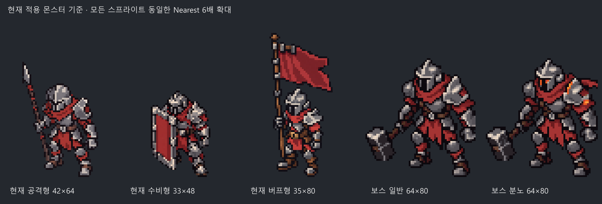
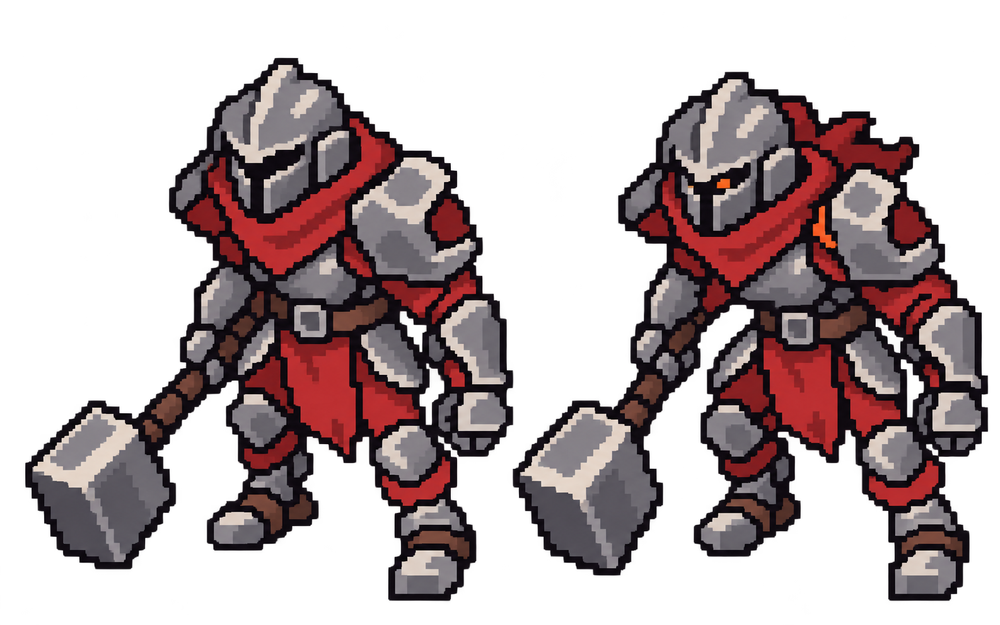
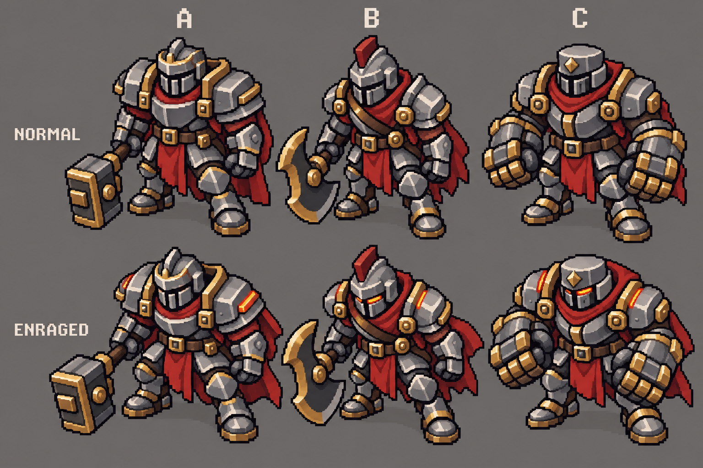

# 보스 아트 시안 검토 — 2026-10-13

상태: 현재 적용 병사3종을 고정 화풍 기준으로 확정. 사용자가 V3 오른쪽 안광 버전을 선택해 일반/분노 공통 보스 외형으로 Unity 적용 완료. [적용·검증 기록](../../development/boss_art_applied_20261013.md). 전투 밸런스 승인은 별도.

## 최신 시안 V3 및 공통 기준 고정

- 사용자 요청으로 [몬스터 공통 기준](../MONSTER_ART_STYLE.md)을 만들고 AGENTS.md에 생성/수정 전 필수 읽기·실제 기준 병사3종 이미지 확인·동일배율 비교 규칙을 추가했다. 이후 화풍 기준은 처음 시안이나 이전 보스가 아닌 실제 사용하는 Revision2 병사3종이다.
- 문제의 원인은 새 보스의 고해상도 픽셀풍을 실제 게임의 낮은 픽셀 격자와 비교하지 않은 것이다. V3는 기준 병사3종 Nearest8배 참조판으로 내장 image_gen 재생성 후 sharp로 실제 낮은 캔버스/팔레트 정규화했다. 기존 병사 파일은 수정하지 않았다.
- `boss_hammer_v3_generated.png`는 생성 원본. `boss_normal_v3_64x80.png`, `boss_enraged_v3_64x80.png`는 두 투명 시안의 실제64×80px 정규화본이다. 병사3종에서24색 대표값을 추출해 맵핑, 분노에만 주황 상태색2종 허용. 팔레트와 출처는 `palette_v3.json`, 프롬프트는 `prompt_v3.txt`.
- 실제 격자 변환과 비교 재현: `normalize_v3.cjs reference`로 현재 병사 참조판, `normalize_v3.cjs finish`로 V3 정규화/비교판을 생성한다. nearest로 축소하고 alpha를0/255로 정리하며 새 미세 색을 추가하지 않는다. 분노는 눈/어깨 국소표시이고 갑옷 전체 색변환은 하지 않는다.
- 비교판은 모두Nearest6배 확대, 발 하단 표시 기준선 일치. 두 보스의 불투명 전체 높이는66px로 수비형48px의약1.375배다. 새 캔버스 크기 자체를 몸 크기로 간주하지 않는다. 실제 발 접촉 중심의 X좌표/게임 PPU/그림자/체력바는 적용 전 검토할 사항이다.
- `validate_v3.py`로 두64×80, alpha0/255, 허용 팔레트만 사용, 불투명 마지막 행73 검사. `validation_v3.json`에 실제 결과 저장. 이는 기술적 검사이며 사용자 화풍/보스 아트 승인 또는 게임 회귀 결과가 아니다.
- 직접 비교에서 V1/V2의 다른 픽셀 밀도·금색 장식·둥근 장갑이 줄고 기준 병사와 같은 철회색/붉은 천/각진 갑옷으로 가까워졌다. 동일 화가 인상의 최종 판단은 사용자 검토로 남긴다.
- sharp SVG 글자 렌더에서 sandbox Fontconfig 캐시 경고가 출력됐으나 비교 PNG 생성 성공·한국어 글자 직접 확인. 게임/Assets·씬·프리팹·BGM·HUD 변경, 새Unity Play/테스트/빌드 없음. 시작 복구 기준 `d1086a5`.
- 종료 전 에디터 재조회: CD/6000.6.2f1 ready·stopped·compiling=false·domainReload=false. 현재 전투 씬active/loaded·dirty=false. 읽기 조회만 수행했으며 새 실행 검증으로 간주하지 않는다.

## 이전 시안 V2

- 사용자 요청: 기존 병사 스프라이트와 픽셀 표현을 맞춰 다시 시안 제작.
- 내장 image_gen, 기존 공격형/수비형 Source 이미지 2장을 스타일 참조. 최종 프롬프트는 `prompt_v2.txt`. 첫 A안 망치를 재시안의 출발점으로 사용한 것이며 사용자 A선택 승인으로 간주하지 않는다.
- 왼쪽 일반/오른쪽 분노. 금색 장식을 제거하고 철회색·붉은 천, 각진 갑옷, 좁은 허리와 상대적으로 긴 다리, 단순한 망치 형태로 수정. 분노는 작은 주황색 눈/어깨 표시와 뒤로 뻗은 천으로 표현.
- 출력은 고해상도 투명 배경의 픽셀풍 시안이다. 기존 병사의 33×48px와 동일한 실제 픽셀 격자로 정규화 완료한 게임용 원본이 아니다. 프롬프트의 64×80 셀·65px 높이는 제작 목표이며 실제 출력 규격/정렬 검증 결과로 기록하지 않는다.
- 직접 시각 확인: 이전 V1의 금색 장식·둥글고 짧은 비율이 줄고 기존 병사의 철제 갑옷/천/명암 형태와 가까워졌다. 실제 낮은 해상도 정규화·두 상태 발 중심·1.4배 게임 크기·체력바 겹침 검토는 남음.
- 이번 범위는 시안만 제작. Assets·원본 프리팹·씬·BGM·HUD 변경 없음, Unity/Play/회귀/빌드/실행파일 실행 없음. 시작 복구 기준 `a2ac7e7`.

## 현재 기준과 조사

### V2 나란히 비교

사용자는 이후에도 새 시안만 따로 제시하지 않고 처음 제작한 기존 병사와 계속 나란히 비교하도록 요청했다. `original_soldiers_vs_boss_v2.png`의 첫 줄은 처음 제작한 `20260930/Sprites` 병사3종, 둘째는 실제 사용하는 `Revision2/Sprites` 병사3종, 셋째는 V2 일반/분노다. 두 병사 행은 같은 Nearest5배 확대이며 보스는 비율 검토용 크기다. 재현은 `compare_v2.py`.

직접 비교에서 V2의 색상·각진 갑옷·긴 다리 비율은 수정 병사에 가까워졌다. 다만 보스의 외곽선과 미세 명암은 더 촘촘하고, 초기 병사보다 밝고 단정한 인상이다. 고해상도 픽셀풍 시안이라 현재 게임의 실제 낮은 픽셀 격자와 완전히 맞췄다는 판단은 하지 않는다. 다음 시안 검토도 동일한 기준 병사3종과 일반/분노를 함께 표시한다. 사용자가 초기 병사 외형으로 복귀를 승인한 것은 아니다.

- AGENTS.md, UNITY_HANDOVER.md, LOCAL_GIT.md, 보스/증강 구현 기록, 전투 효과 스타일, Revision2·그림자 비교 기록을 확인했다.
- 최신 노션 [전투 화면 아트 방향](https://www.notion.so/3ea389dbfc6881dca4d6fe9ca0b35058), [적/보스](https://www.notion.so/3df389dbfc6881ea9f5ec4e0f7b8084c)를 조회했다. 노션 아트 문서의 과거 라운드 구현 설명은 최신 로컬 구현 상태로 간주하지 않는다.
- 현재 방향: 오염된 병사 군대의 지휘관형. 짧은 비율, 회색 갑옷과 차분한 붉은 천, 큰 픽셀·단순한 형태. 이번 시안은 새로운 능력을 정하지 않는다.
- 실제 참조: `Assets/Art/ScreenTests/20261008_Depth/Prefabs/` 8종. 본체 SpriteRenderer의 PPU 32·배율 0.6. 기술병 36×48, 공격형 42×64, 수비형 33×48, 군기형 35×80, 단일 포탑 52×64, 범위 51×56, 지원 40×64, 코어 90×96px. 이는 현재 검토 규격이며 전체 게임 최종 픽셀 규격은 미확정이다.
- 수비형·기술병·단일 포탑의 임포트를 에디터 API로 확인: Point·Uncompressed·mipmap 없음. 발/받침대 중심과 별도 그림자 구조 유지.
- 원본 및 정규화된 병사 3종, 기술병, 포탑, 과거 보스 진단 화면을 직접 확인했다. 상부 면이 보이는 사선 3/4 시점을 제작 참고로 사용하며 최종 카메라 시점을 확정하지 않는다.
- Assets 파일 목록을 조사한 결과 별도 보스/지휘관용 이미지·프리팹은 발견하지 못했다. 기존 수비형은 임시 보스 기반으로만 사용 중이다.
- `Assets/Art/Enemies/Source/BiologicalBeasts_Concept_v1.png`, `BiologicalBeasts_Concept_v2_Shadow.png`의 코뿔소·멧돼지는 큰 실루엣 후보이나 매끈한 동물형 콘셉트여서 현재 병사형/픽셀 방향과 맞지 않는다. 직접 재사용 비추천. 임시 Guardian 이미지는 플레이어 자료다.

## 시안

위 일반, 아래 체력 50% 이하 분노. A/B/C는 보스 외형 후보이며 능력·무기 공격 기능을 추가하는 승인이 아니다.

| 안 | 대표 실루엣 | 판단 |
|---|---|---|
| A | 넓은 어깨·낮은 투구 마루·대형 사각 망치·짧은 망토 | 추천. 창/방패/군기와 다른 사각 무기, 일반 적과 같은 군대 인상 |
| B | 초승달 도끼·투구 장식·대각 띠 | 무기 구별이 쉽지만 공격형의 긴 장비와 비교 필요 |
| C | 넓은 양손 금속 주먹·평평한 투구·짧은 망토 | 폭이 읽히지만 수비형 중장갑과 비교 필요 |

분노는 갑옷 전체를 붉게 바꾸지 않고 주황색 눈/어깨 일부와 앞으로 기운 자세·망토 변화로 표현한다. A안 시안의 눈 표시와 작은 화면에서의 변화 판독은 최종 제작 시 보완할 항목이다.

## 승인 후 제작 기준

### 기본 병사와 직접 비교한 후속 판단

사용자 요청으로 현재 Revision2의 공격/수비/버프 3종 원본을 6배 Nearest 확대하고 보스 시안과 나란히 비교했다. 비교 이미지는 `soldiers_vs_boss_v1.png`, 재현 스크립트는 `make_comparison.py`. 위 병사는 같은 확대 배율이며 아래 보스는 형태 검토용 축소로 실제 게임 크기나 픽셀 밀도 일치의 증거가 아니다.

- 공통: 회색 갑옷·붉은 천·상부 면이 보이는 사선 시점과 금속 하이라이트.
- 차이: 새 보스는 기존 병사보다 몸통/어깨가 둥글고 두꺼우며 머리가 크고 다리가 짧다. 기존 병사는 더 가늘고 각진 갑옷과 긴 팔다리의 인상이다.
- 새 시안은 금색 테두리·장식·미세 명암이 많아 기존의 절제된 철제 병사보다 화려한 기사처럼 보인다. 현재 고해상도 시안은 실제 병사의 낮은 픽셀 밀도와 맞지 않는다.
- 기존 병사도 사선 시점이지만 새 보스의 넓은 가슴/양 어깨는 정면에 가까운 인상을 준다. 최종 시점 일치는 아직 미확인이다.
- 초기 A안 추천은 무기 실루엣 구분만의 판단이다. 화풍 일치까지 승인 가능한 안으로 추천하지 않는다. 사용자의 외형 선택은 아직 없으며 재제작도 이번 비교에서는 하지 않았다.
- 후속 방향: 현재 병사의 머리/다리/각진 갑옷 비율과 철회색·붉은 천을 유지하면서 어깨·투구·새 무기의 큰 윤곽을 확대한다. 금색 장식을 줄이고 실제 작은 픽셀 규격에서 새 실루엣을 검토한다.

- 선택된 안의 일반·분노 정지 스프라이트 두 장을 실제 투명 배경으로 제작. 보행/공격 프레임 애니메이션은 별도 범위다.
- 현재 임시 보스의 수비형 대비 1.4배 크기를 비교 출발점으로 삼되 실제 불투명 윤곽을 기준으로 맞춘다. 시안의 고해상도 픽셀풍 결과를 곧바로 최종 스프라이트로 사용하지 않는다.
- 두 상태의 캔버스·발 접촉 중심·방향·장비를 맞추고 실제 크기의 축소 비교를 검토한다. 현재 PPU32/0.6과 맞추는 낮은 해상도 정규화는 승인안 제작 후 결정한다.
- 최종 원본은 새 버전 경로에 보관하고 Unity CLI/에디터 API로 가져오기·설정을 진행한다. 원본 프리팹·SampleScene·아트 비교 씬을 보존한다.
- 분노는 기존 Enraged 상태에 연결하고 체력/속도/피해/골드 규칙은 담당 시스템에 유지한다. 최종 게임 화면의 크기·그림자·체력바·숫자 겹침은 아직 미검증이다.

## 검증·복구

- 작업 시작 복구 기준 HEAD `50f6fd581deb748a8fef5c8ad9b05b29d2b70adb`. 보스 기능 복구 기준 `7a150a7`도 유지. 기능/Unity 변경 없이 시안·문서만 추가하므로 LOCAL_GIT.md에 따라 빈 시작 커밋은 만들지 않는다.
- Unity 6000.6.2f1/CD 연결 ready, Play stopped, compiling=false, domainReload=false. 전투 씬 active/loaded, dirty=false 확인. 씬 저장·Play 시작·빌드·실행파일 실행은 수행하지 않았다.
- Assets/Packages/ProjectSettings 변경 없음 확인. EditMode73/PlayMode6은 이전 기능 검증이며 이번에 재실행하지 않았다.
- 다른 작업의 BGM/HUD 인수인계 변경과 AudioProduction, bgm_sketches 문서를 보존한다. sandbox에서 font_tools_vendor 접근 거부가 삭제처럼 표시될 수 있어 삭제 판정을 하지 않고 커밋 대상으로 지정하지 않는다.
- 생성 도구: 내장 image_gen. 입력 참조 3장과 최종 프롬프트는 `prompt.txt`에 보관. 출력 1536×1024 비교 시안, 회색 배경 포함. Unity용 투명 원본이 아니다.
- 종료 커밋에는 이번 시안/조사 문서와 인수인계의 보스 작업 항목만 포함한다. GitHub 연결·push 없음.
