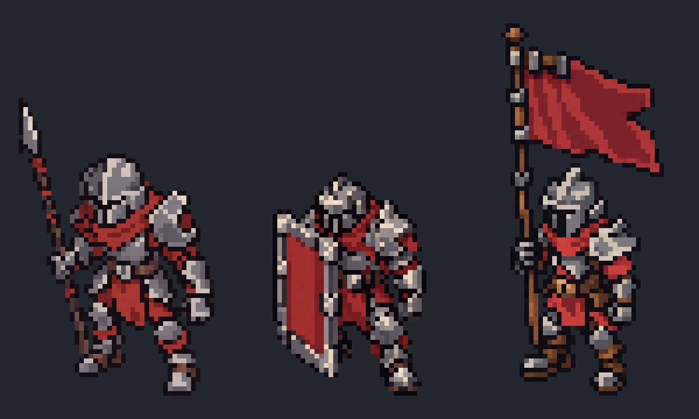

# 코어 가디언 몬스터 아트 공통 기준

2026-10-13 사용자 확정: 앞으로 몬스터 아트풍은 **현재 게임에 적용된 몬스터**를 기준으로 유지한다. 새 개체마다 다른 스타일을 탐색하지 않고 한 사람이 같은 세트를 계속 제작한 인상을 만든다. 이 문서는 몬스터의 시각 제작 기준만 관리한다. 능력·라운드·보상은 해당 시스템 문서가 담당한다.

## 매 작업의 시작

1. 이 문서와 UNITY_HANDOVER.md의 최신 아트 상태를 읽는다.
2. 아래 세 병사의 실제 파일을 이미지로 열어 본다. 글로 적힌 '픽셀풍'만으로 대체하지 않는다.
3. 생성/수정 프롬프트에 이 실제 파일을 스타일 참조로 넣는다. 과거 보스 시안을 화풍 원본으로 삼지 않는다.
4. 새 시안은 실제 낮은 픽셀 격자로 정규화한 후 기준 병사와 **같은 Nearest 정수 확대 배율**의 비교판으로 검토한다. 크기를 제각각 맞춘 고해상도 그림은 픽셀 일치 판정에 사용하지 않는다.

## 고정 기준 파일

현재 실제 참조 프리팹: `Assets/Prefabs/Gameplay/Units/{enemy_attack,enemy_defense,enemy_buff}.prefab`.

| 유형 | 기준 스프라이트 | 현재 크기 |
|---|---|---|
| 공격형 | `Assets/Art/Characters/Enemies/Sprites/enemy_attack_v2.png` | 42×64px (창 포함) |
| 수비형 | `Assets/Art/Characters/Enemies/Sprites/enemy_defense_v2.png` | 33×48px |
| 버프형 | `Assets/Art/Characters/Enemies/Sprites/enemy_buff_v2.png` | 35×80px (군기 포함) |

같은 폴더의 `Revision2/Source`는 생성 참고 원본이고 게임 픽셀 규격 자체가 아니다. 이전 `20260930/Sprites`의 초안은 이력 자료이며 현재 기준과 구분한다. **V1/V2 보스 시안도 공통 기준이 아니다.** 최신 씬의 참조가 바뀌었다면 에디터 API로 확인하고 사용자가 승인한 새 기준으로 이 문서를 갱신한다.

## 같은 제작자의 표현 유지

- 시점: 현재 병사처럼 상부 면이 보이는 사선 3/4. 머리·어깨·발의 방향을 함께 맞춘다. 새 개체만 정면/측면이나 다른 카메라 각도로 바꾸지 않는다.
- 비율: 현재 병사의 머리/몸통/허리/다리 비율에서 출발한다. 상대적으로 길고 가는 팔다리와 각진 철제 갑옷을 유지한다. 머리만 커지고 다리가 짧아진 귀여운 중장갑 기사 형태로 바꾸지 않는다.
- 형태: 투구·어깨·정강이·장비가 각진 큰 덩어리로 읽힌다. 보스는 같은 군대에서 더 큰 어깨·장비 등 대표 윤곽으로 구별한다. 둥근 거대 몸통/보석/장식 추가로 화풍을 바꾸지 않는다.
- 색: 기준 파일에서 추출한 철회색·어두운 외곽선·크림색 하이라이트·차분한 붉은 천·갈색 가죽을 공유한다. 보스만 금색 테두리·청록 수정·새 재질로 화려하게 꾸미지 않는다.
- 명암: 병사와 같은 큰 색 면을 쓴다. 작은 스크래치·리벳·미세 단계·매끈한 그라데이션은 늘리지 않는다. 외곽선·밝은 금속 면의 픽셀 폭도 함께 비교한다.
- 픽셀: 큰 그림에서 픽셀처럼 보이는 것과 실제 게임 픽셀 격자를 구분한다. 새 원본은 낮은 정수 픽셀 캔버스에 맞추며 픽셀 하나를 확대하면 균일한 사각형이 되게 한다. 보스 크기가 커져도 픽셀 자체를 더 작게 만들어 세부 밀도를 높이지 않는다.
- 일반/분노: 장비·캐릭터 정체성·캔버스·발 접촉 중심 유지. 분노는 작은 주황색 눈/표시처럼 국소 변화로 읽히게 한다. 전체 붉은 틴트·큰 불꽃은 기본 방식으로 쓰지 않는다. 상태 색은 일반 병사 팔레트와 구별해 따로 기록한다.

## 게임 크기와 검토

- 현재 PPU32, 본체 배율0.6, Point·무압축·mipmap 없음은 확인된 임포트/배치 기준이다. 최종 전 게임 픽셀 규격을 확정한 뜻은 아니다. 유닛 발 접촉 중심과 기존 별도 그림자 구조를 유지한다.
- 현재 보스는 수비형의1.4배 크기다. 새 보스의 시각 크기는 이 기준과 비교하되 무기/깃발 포함 전체 이미지 높이를 몸 높이로 오인하지 않는다. 점유·충돌 범위는 아트로 변경하지 않는다.
- 비교판에 기준3종 + 새 보스 일반/분노를 함께 놓는다. 모두 같은 픽셀 확대 배율, 같은 배경, 발 기준선으로 확인하고 원래 픽셀 크기도 표시한다. 실제 게임 크기 비교와 확대 비교는 목적을 구분한다.
- 검토 항목: 같은 군대/같은 화가인가, 머리/다리/갑옷 비율인가, 철회색/붉은 천인가, 픽셀/명암 밀도인가, 장비 윤곽으로 유형이 읽히는가, 분노가 작은 화면에서 구별되는가.
- 시안 생성·기술적 정규화·사용자 아트 승인·Unity 적용을 각각 구분한다. 사용자가 새 몬스터를 선택하기 전 기준 몬스터/원본 프리팹/씬을 교체하지 않는다.

## 기록

날짜별 시안·프롬프트·비교·검증은 [보스 제작 기록](20261013_BossReview/REVIEW.md)에 보관한다. 이 문서는 공통 기준만 유지한다. 사용자 지시로 공통 기준이 바뀌면 이 문서를 교체 갱신하고 AGENTS.md의 연결을 유지한다.
