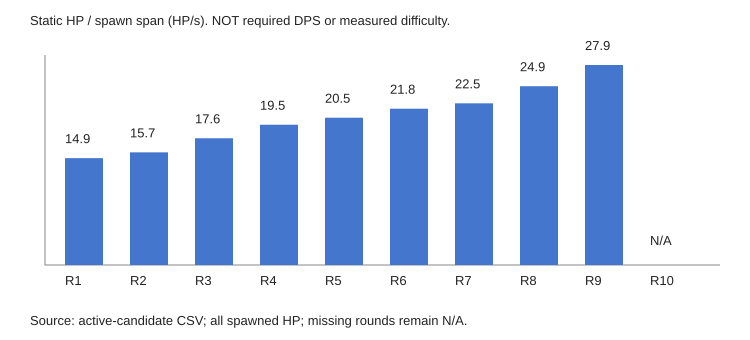

# 코어가디언 1~10라운드 밸런스 시험 분석

작성·조회: 2026-10-13 (Asia/Seoul). 사용 스킬: `core-guardian-balance`. 게임/기획 변경 없이 분석했다. 이번 작업은 정적 계산과 기존 실제 Play 계측의 재검토이며 새 전투 시뮬레이션이나 사람 플레이 측정이 아니다.

## 1. 현재 밸런스 상태 요약

**초반의 문제는 전체 난이도가 낮다기보다, 플레이어가 직접 기여하거나 성장 차이를 느끼기까지 공백이 있다는 가설이 가장 유력하다.** 기존 성공 배치에서도1~2R은 기술병 피해0, 구매0으로 포탑 혼자 처리했다. 반대로 다른 두 배치는6/7R에 패배했으므로 모든 빌드가 지나치게 강하다고 일반화할 수 없다.

현재 실행은1~9R이며10R 보스·증강은 미구현이다. 기획상 첫 증강은10R 보스를 처치하고 라운드가 종료된 뒤에만 얻는다. 현재 플레이에서는 첫 증강의 재미를 시험할 수 없으며,10R은 아래 기획 시나리오로만 분석했다. 압도적 빌드 완성의 재미는 보존하고 첫 성장/기여와 이후 의미 있는 선택을 앞당기는 방향을 우선 검토한다.

## 2. 수치와 근거에 기반한 문제점

### 확인한 자료와 확인하지 못한 자료

| 근거 유형 | 확인 범위 | 한계 |
|---|---|---|
| 최신 노션 직접 조회 | 루프·웨이브 규칙·편성·적/보스·플레이어 전투/성장·타워·재화·증강·피해 계산, 총10페이지 | 페이지 마지막 수정은2026-09-28~10-09. 일부 본문에10-10 갱신 기록. fetch 응답의 truncated/unknown metadata는 제공되지 않아 부재를 완전성 보증으로 해석하지 않음. 담당 본문은 읽음 |
| 현재 Unity 상태 | CD ready,6000.6.2f1, 전투 씬 loaded/active/dirty=false, Play stopped, compiling=false, domainReload=false,timeScale1 | Play를 새로 시작하지 않아 메모리 Session의 현재 로딩값은 측정하지 않음. 콘솔 오류3건은 별도 검증 기록 참조; 이번 분석이 게임 오류0 검증은 아님 |
| 실제 적용 정적 연결 | 전투 씬의 CSV5종 TextAsset GUID↔Resources CSV meta, Prototype.Start→CombatData.Load→Session, 논리 경로92타일 | 디스크에 저장된 참조/계산 확인. 과거 기초 코드나 오래된 Windows 빌드를 현행 근거로 쓰지 않음 |
| 실행 CSV | enemies,towers,stage,upgrades,waves | 수치는 provisional.10R 행과 Boss enum 없음 |
| 과거 실제 Play 계측 |2026-10-10 정상 API/Update 기반3정책, JSON 원본과 실행방법 재검토 |5배속·준비 시작 명령·고정 배치·정책별1회. 사람 입력/재미·통계·현재 날짜의 새 플레이 아님 |
| 미확인 |1배속 사람 체감, 배치별 반복 통계,10R 보스 처치시간, 증강11R 적용/중첩 실전값, 최적 빌드, 최종 밸런스 승인 | 추측으로 채우지 않음 |

노션 원문과 수정일은 [조회 사본](notion_sources.json)에 보존했다. 향후 분석은 사본 대신 최신 페이지를 다시 읽는다. 구현 코드와 연결 근거는 [인수인계](../UNITY_HANDOVER.md), 과거 실제 측정은 [측정 방법과 결과](../natural_playtest_20261010.md)를 참조한다.

### 라운드별 수급과 위협

1~9R은 실행 CSV 정적 합산. 골드는 전원 처치, 수정은 완료 가정이며 누적에는 지출을 빼지 않았다. 실측 시간은 과거 근접 배치1회 기록이다. 예상 위협은 상대적 가설이며 난이도 확정/승률이 아니다.

| R | 공격/수비/버프/보스 | 총HP | 마지막 생성(초) | 골드/완료수정 | 누적 골드/완료수정 | 과거 전투시간(초) | 예상 위협·선택 신호 |
|---|---|---:|---:|---|---|---:|---|
|1|15/0/0/0|375|25.2|45/20|45/20|39.7|소개, 성공 배치에서 기술병 기여0 |
|2|16/0/0/0|400|25.5|48/20|93/40|40.0|거의 같은 편성, 강화비 아직 부족 |
|3|14/2/0/0|450|25.5|50/20|143/60|44.6|수비형 첫 등장, 첫 기술병 강화 여력 |
|4|14/3/0/0|500|25.6|54/20|197/80|44.9|수비 증가, 종료 후 첫 타워 강화비 |
|5|13/4/0/0|525|25.6|55/25|252/105|46.7|수비 증가, 다음 준비에 설치/강화 경쟁 |
|6|13/4/1/0|555|25.5|61/25|313/130|45.1|버프 도입, 불리한 저장 배치 패배 |
|7|13/4/1/0|555|24.65|61/25|374/155|44.1|같은HP·간격 단축, 불리한 강화 배치 패배 |
|8|13/5/1/0|605|24.3|65/25|439/180|44.5|수비 증가, 동일능력3회 비용 확보 |
|9|13/5/2/0|635|22.8|71/25|510/205|43.9|버프2집단, 밀도 상승 |
|10 기획|10/3/1/1|730|16.5|168/35|678/240|미측정|보스HP300·0.6→0.78타일/초·코어피해10. 처치 실패 시증강/보스골드 없음 |

10R의 일반 적HP430+보스300=730, 일반 골드48+보스120=168은 [편성](https://www.notion.so/3e6389dbfc6881c5aa2bed3c32047474)·[적/보스](https://www.notion.so/3df389dbfc6881ea9f5ec4e0f7b8084c)·[재화](https://www.notion.so/3e3389dbfc688160a9b7efcc83505cb3)의 **미실행 가안 계산**이다. 보스 방어력/타깃 우선순위/버프 적용 상세는 이번 자료에서 확정하지 못했으므로 보스 DPS·정확한 처치시간은 계산하지 않았다.1~9R 핵심 수치와 승인 생성 일정은 노션/구현이 일치했다.

총HP÷첫~마지막 생성 구간은1R14.88→9R27.85 HP/초로 약1.87배다. 필요한 방어DPS나 실측 난이도가 아니다.10R은 실행 데이터가 없어 N/A로 둔다. 원본은 [정적 CSV](static/rounds.csv), [계산·출처 SHA256](static/rounds.json), [성장 계산](static/growth.json).

### 첫 성장과 첫 증강까지의 공백

- 시작골드0.2R 종료까지 전원 처치해도93골드로 첫100골드 강화가 불가능하다.3R 전투 중100에 도달할 수 있다. 과거 자동 구매 정책은 준비에만 구매하여4R에 첫 강화했다. 획득 가능 시점과 정책의 구매시점은 다르다.
- 같은 능력치100/140/190골드, 누적100/240/430은3/5/8R 종료까지 마련된다. 서로 다른3능력치 각1단계는300골드로6R,4능력치는400골드로8R까지 가능하다. 최종510골드는 집중3회 후80이 남는다. 골드 누수는 이 시점을 늦춘다.
- 첫 포탑100수정을 쓰면 잔액0. 첫 강화80은4R 종료→5R 준비, 두 번째 설치100은5R 종료→6R 준비에 가능하다. 한 포탑 동일 능력치2회 비용180은8R 종료→9R 준비. 다른 두 능력치 각1회160도8R 종료에 가능하다. 추가설치100과 동일능력 강화2회180을 합친280은1~9R 완료수정205보다 많아 동시 보장이 아니다.
- 기존 성공 배치1~2R 전투는 합계79.74게임초이며 기술병 피해0. 준비를 모두 기다리면1~2R 시작 준비100초를 더해 약179.74초가 된다. 이 시간 전부가 무행동인지는 사람 플레이로 미측정이다.
- 기존 성공 배치1~9R 전투 합393.60초. 같은 전투시간이1배속에서도 유지되고1~10R 준비50초를 모두 기다린다는 **혼합 추정 시나리오**에서는10R 전투 진입까지893.60초(14분53.6초). 시작 버튼으로 준비를 즉시 넘기면 약6분33.6초+구매/조작 시간이다. 첫 증강은 여기에 미측정10R 종료 시간이 더 필요하다. 배치 실패 시 전투가 더 길고 보스 미처치면 첫 증강을 못 얻는다. 실제 첫 증강 대기시간 실측으로 보고하지 않는다.

### 성장 전후 DPS·발수·처치시간

현재식 `floor(max(0,D*(1-defense/100))+.5)`로 명중별 반올림. 다음은 사거리·비행·초과피해·다른 공격원을 제외한 지속 타깃 **정적 계산**이다.

| 기술병 공격력 강화 | 무방어 DPS | 공격형25HP 발수/공격간격시간 | 수비형50HP 방어1 발수/공격간격시간 |
|---|---:|---|---|
|0회:10|10|3발/2초|5발/4초 |
|1회:12|12(+20%)|3발/2초|5발/4초 |
|2회:14|14(+40%)|2발/1초|4발/3초 |
|3회:16|16(+60%)|2발/1초|4발/3초 |

시간은 첫 공격 즉시 발사 가정의(발수−1)/rate로 **완전한 처치시간이나 클리어 시간 예측이 아니다**. 첫 공격력 강화는25/50HP 적의 발수 임계를 넘지 못한다. 다만 포탑과 합동 공격, 남은 체력, 사거리/투사체 속도에 따라 실전 이득이 달라져 무효 강화라고 단정할 수 없다. 성장 문서의22HP 비교 예시를 실제 적으로 바꾸어 계산하지 않았다.

| 공격원 | 공격형 지속 DPS | 수비형 지속 DPS | 주의 |
|---|---:|---:|---|
|Single 기본|15.6|14.4|12.5가 방어0에서는13, 방어1에서는12로 반올림 |
|Multi 기본 대상1명|7.8|7.2|최대3명 지속 시23.4/21.6. 스플래시가 아닌 대상별 투사체 |
|Single 공격력1강|18|18|공격형2발 유지, 수비형5→4발 |
|Single+지원20%|18|18|지원은 기술병에게 적용되지 않음 |

적이 기본속도로 직선 경로를 지나고 두 공격원의 배치가 기존 성공 위치라면, 기술병(15,16)의 사거리3과 상단y18 교차 길이는2√(9−4)=4.47타일, Single(14,16) 사거리3.5는2√(12.25−4)=5.74타일이다. 공격형 노출은 약4.47/5.74초, 수비형은속도0.8로약5.59/7.18초. 버프20%가 노출 내내 적용되면 각각÷1.2지만 실제 버프 동행은 검증이 필요하다. y15·사거리3은y18과 접점이라 연속 노출길이가0에 가깝다. 이것이 배치로 화력이 사라지는 이유의 근거다. 곡선/다른 경로 구간·투사체·시뮬레이션은 포함하지 않았다.

기존 실측에서 기술병/포탑을 모두 한 칸 가까이 옮긴 정책은9R 코어20으로 완료했지만, 이전 위치에서 저장 정책은6R, 공격력 강화 정책은7R 패배했다. 기술병 피해는 두 실패 정책 전 라운드0이었다. 성공 배치의 Multi도6~7R 피해0,8R11·9R43에 그쳤다. 따라서 위치/실제 대상 수 확인 없이 Multi 약화·불필요 판정이나 단일 위치만의 인과 결론을 내릴 수 없다. 성공 전투시간은 총HP375→635 증가에도 약40~47초로 유지됐지만, 정책과 구매/적구성이 함께 바뀌었으므로 성장의 단독 인과 효과가 아니다. 실패 배치 누수는 전투107~114초로 반복 체감을 늘렸다.

### 증강 성능과 실제 획득 가능성

[증강 기획](https://www.notion.so/3e6389dbfc6881bf9600d5f42fb68a44)에만 있는 효과다. 기술병 공격력16·rate1·무방어 지속명중 가정:

| 첫 선택 카드 | 이상적 기술병 DPS | 변화/한계 |
|---|---:|---|
|실버 전투+2|18|+12.5%, 공격형2발 유지 |
|골드 전투+4/둔화|20|+25%, 이동속도20% 감소1초는 타워노출도 돕지만 동일적 중첩 없이 갱신 |
|플래티넘 전투 추가1발|32|+100%, 같은 대상이라 작은 적의 초과피해/다른 투사체 낭비는 증가할 수 있음 |

지원20%와 타워 증강10/30/60%는 합산되어Single 입력12.5×(1+.2+증강율). 무방어 DPS는19.2/22.8/27.6이며 지원만 있을 때18 대비 약+6.7/+26.7/+53.3%. 버프율을 단순히 별도 곱하지 않는다.강한 빌드의 폭발적 성장 자체는 보상이며 일괄 하향 이유가 아니다.

순수 효과식에서 실버 전투n회·골드 전투m회·플래티넘 전투k회는 무방어 이상적 `(현재강화피해+2n+4m)×rate×(1+k)`. 둔화는20%로 유지·지속만 갱신한다. 다만 이 스택이 실제 획득 가능한지 별도 검증해야 한다.

현재 등급별6종, 이미 선택한 카드는 미선택 카드 고갈 전 제외, 화면3장 중복 제외라는 규칙 때문에 **같은 카드 최초 재선택은 빨라도5번째 증강(50R)**에 가능하다. 이전4회 같은 등급의 서로 다른 카드를 골랐고 다음 화면3장이 모두 그 등급일 때 남은 미선택2종을 먼저 채우고3번째 자리에 이전 카드가 복귀하는 경우다.10R 직후에는 카드1개뿐이며 중첩이 없다. 서로 다른 두 등급의 같은 카드까지 각각 두 번 선택하려면 각 등급 최소5회, 총10회가 필요하므로10~90R의9회 선택 범위에서는 그 조합은 불가능하다. 가상 스택식과 현행 달성 가능한 빌드를 구분한다.

3장 중 플래티넘 하나 이상14.2625%, 골드 이상65.7%는 **등급 표시 확률**이며 원하는 전투 카드 획득확률이 아니다. 최초 선택의 플래티넘 전투 카드가 화면에 나올 확률은 등급별6카드 균등·중복 제외를 반영하면 기대 플래티넘 장수3×.05를6으로 나눈2.5%다. 플레이어가 실제 선택하는 확률은 선택 정책에 따라 다르다. 플래티넘 획득을 초반 재미의 필수 조건으로 둘 수 없다.

## 3. 원인 가설

| 가설 | 지지 근거 | 반증/추가 확인 |
|---|---|---|
|첫 선택과 성장 체감이 늦음|2R까지 강화불가, 첫 타워강화5R준비, 첫 증강10R후|초보자가 설치/배치 학습만으로도 초반에 충분히 몰입하는지 |
|강화를 해도 직접 기여가 보이지 않음|첫공격력1강 발수 유지, 실패 배치 기술병 피해0|동일배치의 공격력/사거리 강화 A/B와 합동처치 시간 차이 |
|쉬움보다 반복/대기가 문제|1~2R같은적, 성공 배치 포탑 독립처리, 준비50초|시작 버튼 실제 사용·무행동·지루함 점수 |
|배치 판독 실패가 지루함과 난도격차를 함께 만듦|1칸차 정책 완료/패배, 누수전투107~114초|기술병만/포탑만 이동해 원인을 분리하고 사거리 이해 측정 |

## 4. 해결 방안 3가지와 장단점

| 안 | 구체적 제안(미적용) | 장점 | 단점·변경 범위 |
|---|---|---|---|
|A. 첫 성장 선택을 앞당기고 기여를 읽기 쉽게|2R까지 첫100골드 마련하는 수급 시나리오를 비교. 예: 시작골드20 가안은2R중 첫강화 여력. 집중/분산·공격력/사거리 선택과 실제 피해변화를 표시. 현재50초 준비/시작 버튼에서 실제 대기행동도 함께 측정|증강10R 규칙 유지, 강한 후반 빌드 유지, 기다림을 성장 선택으로 바꿈|전체수급 증가가 중후반을 바꿀 수 있어 같은 총수급의 시점 재배분 안도 비교. 첫+2 발수 동일 문제는 별도 검증. 재화/성장/HUD 담당 문서 변경 필요 |
|B. 증강 재미를 초반에 먼저 체험|시작 빌드 카드 또는3R 이후 시험용 첫증강을 별도 실험군으로 제공하고10R 보상과의 관계 설계|핵심 재미에 가장 빨리 접근, 조합 기대 형성|현행 보스처치후10라운드마다 규칙 변경. 순수 추가면 수급/중첩/보스가 모두 달라짐. 증강/루프 담당 검토와 별도 승인 필요 |
|C. 초기 전투 리듬과 배치 선택을 조정|1~2R HP 일괄증가 대신 총량을 유지한 짧은 묶음 생성/다른 노출 배치 실험, 초반 반복 길이/준비 사용을 개선|추가 파워 없이 플레이어 보완 역할·공간 선택을 만들 수 있음|초보자 압박 증가·실패 후 증강지연 가능. 승인된 생성순서/시점 변경은 웨이브 담당 검토 필요, 난도 상승만으로 재미 보장 안 됨 |

## 5. 추천 해결책과 이유

**A를 우선 시험한다.** 보스후 증강 규칙을 유지하며 첫 작은 성장/기여를 앞당겨10R까지의 공백을 채울 수 있다. 순서는1배속에서 사거리/기여 판독과 시작버튼 사용을 먼저 확인하고,2R 강화 가능 시나리오를 비교한다. 초기골드 추가가 최종구매횟수와 보스전 성능에 미치는 영향을 따로 기록한다. 공격력만 상향하거나 HP를 일괄 높이지 않고, 사거리/공속 등 선택의 실전 차이와 강력한 증강 후 압도감을 평가한다.

노션 수치와 게임 적용은 변경하지 않았다. A가 사람 플레이에서도 성장/몰입 개선을 못 보이면, 핵심 증강 재미 자체가 너무 늦다는 근거를 모아B를 검토한다.

## 6. 실제 플레이테스트 검증 항목

| 비교 | 기록 지표 | 판단 기준/반증 |
|---|---|---|
|1배속 현행 반복, 숙련도 구분|첫강화/첫선택까지시간, 준비실체류, 시작버튼사용, 기술병피해/사거리밖시간, 조작횟수, 라운드별지루함·성장인지5점|계측공백과 사람의 지루함이 동행하는지. 설치학습 만족이면 쉬운1R은 보존 |
|동일 배치, 공격력/사거리/공속 중1개만 변경|발수·첫명중·실제기여·코어누수·사망투사체손실·클리어시간|명목DPS같아도 노출이 개선되면 선택가치로 인정. 공격력+2의 합동처치 이득 확인 |
|기술병만1칸/Single만1칸/둘다/둘다유지|실제노출·각공격원피해·클리어/실패·이유설명|기존 두공격원 동시이동의 인과 혼동 해소 |
|현행 vs2R 강화가능 시나리오|첫강화인지·몰입·1~9R실패·총골드/구매분포·10R보스 결과|몰입/성장인지 개선이 있고 초보자 이탈·빌드다양성이 악화하지 않는지. 목표 숫자는 기준선 수집 후 결정 |
|10R 구현 후 보스처치/도착 대조,11R 증강효과|첫증강실시간·보스시간·120골드 지급조건·3장룰·효과적용·DPS/클리어 변화|미처치시증강없음·10R종료후선택·별도30초·다음준비50초 분리 확인. 현재 미구현 |
|장기 증강 시뮬레이션과 정상 플레이 대조|후보고갈·중복제외·재선택실제가능라운드·추가발낭비·둔화갱신·버프합산·분위수|강한 빌드보상감을 유지하면서 죽은 선택/회복불가구간 감소. 실제획득불가스택은 별도 가상표시 |

각 정책 여러 번과 여러 사람으로 반복하고 배치·시드·구매·전투/준비시간을 저장한다. 평균만으로 결론내리지 않는다. 현재3정책1회 기록으로 승률·최적배치·최종밸런스를 승인하지 않는다.
