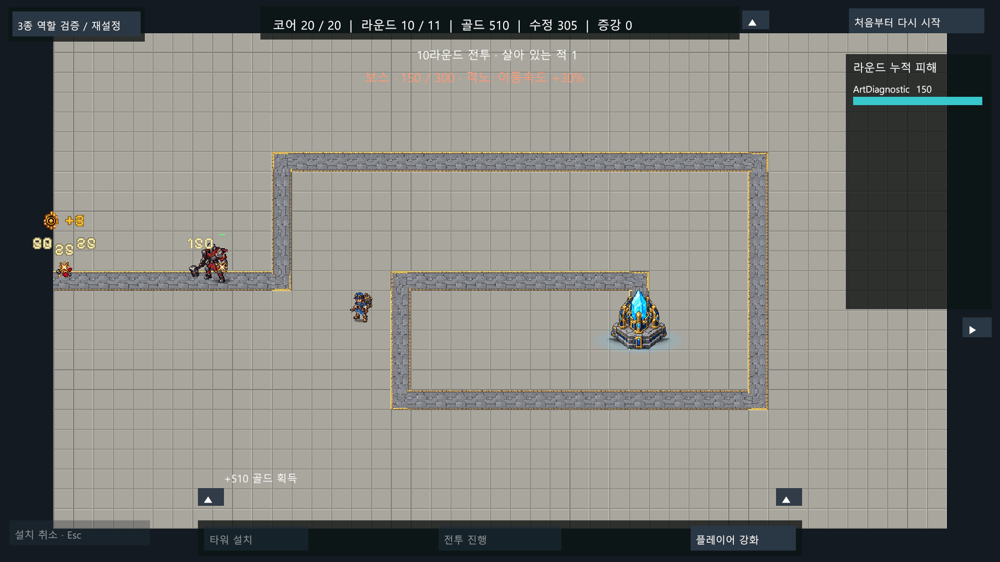

# 안광 보스 아트 적용 — 2026-10-13

사용자가 V3 비교판 오른쪽의 안광 버전을 선택하고 적용을 요청했다. 해당 외형 승인과 전투 밸런스 승인을 구분한다.

## 적용

- 오른쪽 `boss_enraged_v3_64x80.png`를 선택 원본으로 사용. 이름의 enraged는 제작 시안 명칭이며 이제 일반/분노 모두 이 승인 외형을 사용한다. 일반 상태부터 안광이 보이고, HP50% 이하 가속·HUD격노 규칙은 유지한다.
- `Assets/Resources/CoreGuardian/Art/BossEye/BossEye.png`: 실제64×80, PPU32, Point·무압축·mipmap 없음, NPOT 크기 보존, 투명 배경. 선택 원본 바이트를 그대로 복사했다.
- 새 `BossEyePrefab.prefab`: 기존 수비형 원본을 에디터 API로 별도 복제한 독립 프리팹. 본체 Sprite를 교체하고 배율0.6을 유지했다. 기존 임시1.4배 추가 확대는 제거해 실제66px 보스/48px 수비형의 약1.375배 높이 차이가 나온다. 기존 프리팹·씬은 수정하지 않았다.
- 최하단 불투명5행에서 발 접촉 중심을 계산한 custom pivot(54,8.5)px 사용. 본체 localPosition0. 외곽/접촉 그림자 계층은 원본에서 이어받아1.4배, 새 보스 발 형상으로 밀착선 Sprite를 생성했다. ArtDepthSorting도 기존 방식 유지.
- 런타임은 Resources에서 별도 보스 프리팹을 읽는다. 적3종/포탑3종 씬 참조는 유지한다. 보스 전체 보라/붉은 tint를 제거해 승인된 원본 색을 유지한다. 체력바는 보스만 루트Y1.4에 두어 머리와 겹치지 않게 했다.
- 전투 체력·속도·도착 피해·보상·증강은 변경하지 않았다. 새 보행/공격 애니메이션은 제작하지 않았다.

## 실제 검증

- `InstallBossArt_20261013.cs`의 Verify: Resources프리팹, 선택Sprite, white색, 배율0.6, Point/PPU32/무압축/mipmap없음 확인.
- 수정 전 `VerifyBossArt_20261013.Check`는 기존 병사 이미지 사용을 검출해 실패했다. [RED 결과](boss_art_red_20261013.json). 수정 후 같은 검사 통과.
- 실제10라운드 HP300/일반/속도0.6과 HP150/격노/속도0.780000031에서 승인Sprite·white색·실제배율0.6·발루트좌표·체력바상단·그림자3층 검사 통과. 진단으로1~9 강제 처치 후10으로 이동하고 보스를(8,12)에 표시했으며 난이도 실측이 아니다.
- [런타임 검사](boss_art_runtime_20261013.json), [실제 HUD 포함 화면](boss_eye_applied_20261013.png). 화면의 피해/처치 피드백은 진단 잔상이며 정식 사람 플레이 화면이 아니다.
- 최신 회귀 [EditMode73/73](boss_art_editmode_20261013.json), [PlayMode6/6 completed](boss_art_playmode_20261013.json). 기존1~11/증강/재시작 흐름 유지.
- 기존 BuildCombatPrototype.Verify 성공: 전투 씬saved, A길, 적/포탑원본3종 참조, 플레이어(15,10) 유지. 실제 씬/원본프리팹/CSV/HUD/BGM 수정 없음.
- 설치 최초 실행은 마지막 결과의 UnityVector2 JSON순환참조 때문에 오류를 반환했으나 프리팹 저장까지 완료된 상태였다. 벡터를 숫자 배열로 직렬화하도록 수정하고 Main을 다시 실행하지 않고 Verify로 실제 설치 확인. 런타임 게임 오류와 구분한다.
- 캡처 도구가 만든 자체 임시Assets이미지는 문서로 복사 후 AssetDatabase.DeleteAsset로 제거했다. timeScale1 복구, Play종료. 빌드/실행파일 실행 없음.
- 종료 에디터ready/stopped·compiling=false·domainReload=false, 콘솔groundTruth 현재오류0/컴파일실패false 확인. 누적 도구버퍼의 과거 오류/경고와 구분한다. 선택 PNG와 Unity PNG의 SHA256 일치 확인.

## 복구·남은 작업

- 수정 전 Assets/Packages/ProjectSettings 변경 없음. LOCAL_GIT.md에 따라 기존 HEAD `3394eb2`를 복구 기준으로 사용, 빈 시작커밋 없음.
- 이번 변경만 완료 커밋에 포함. 기존 BGM/HUD 인수인계 추가·음악 파일은 그대로 두고 함께 커밋하지 않는다. GitHub 연결/push 없음.
- 외형 선택·적용은 완료. 보행/공격 애니메이션, 사람 플레이의 보스/증강 밸런스 승인, BGM적용은 남음.

