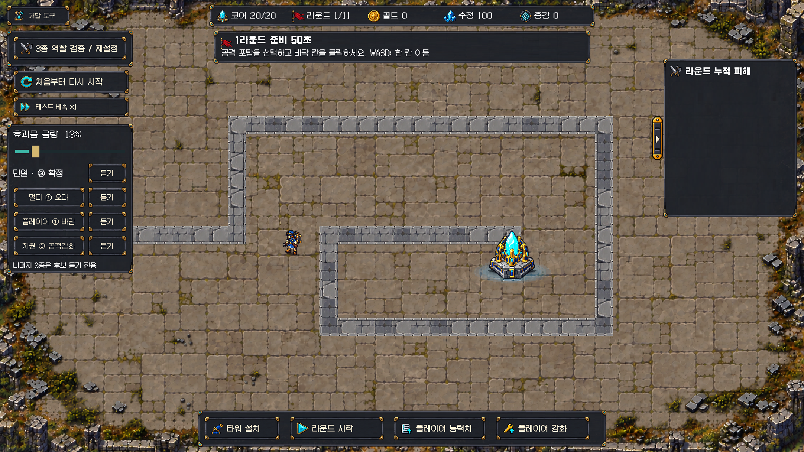

# 단일③ 확정 · 멀티/플레이어/지원 청취 후보

**최신 선택:** 플레이어도③ 확정 적용, 지원은 무음, 멀티는 다른3안으로 교체했다. 아래9종은 이전 청취 이력이다. 현재 사용법/후보/적용은 [최신 사운드 후속](../combat_audio_followup_20261018/README.md)을 따른다.

2026-10-18 사용자 지시로 **단일 포탑은 이전③ Aura_Spawn_1의 기존0.75초 파생**을 실제 발사에 고정했다. `CoreGuardianCombatAudio.SingleShotResourcePath`가 `CoreGuardian/Audio/TowerShot/03_Aura`를 직접 가리키며 과거 후보 저장값으로 바뀌지 않는다. 승인 WAV는 이전 커밋과 바이트 동일하다. 사용자 탈락② Aura_Spawn_3 및 남은① 비교본은 단일 Resources에서 제거했다. 팩 원본은 보존한다.

## 들어보는 방법

Play → 개발 도구. 단일 줄은 **③ 확정/듣기**다. 멀티·플레이어·지원 줄은 왼쪽 버튼으로①②③을 바꾼 뒤 오른쪽 **듣기**를 누른다. 새 후보는 아직 실제 공격/지원 이벤트에 연결하지 않았다. 지원은 직접 공격이 없으므로 버프 반응음 후보이며 버프 수치나 발동 규칙을 추가하지 않았다.

| 대상 | ① | ② | ③ |
|---|---|---|---|
| 멀티 | Aura_Spawn_2 ·0.55초 | Wind_01 ·0.50초 | Water_02 ·0.55초 |
| 플레이어 | Wind_01 ·0.32초 | Poison_01 ·0.35초 | Aura_Glyph_1 ·0.40초 |
| 지원 | Atk_buff_04 ·0.75초 | Def_buff_01 ·0.75초 | Aura_Glyph_2 ·0.65초 |

명칭은 원본 분류다. 독/물/바람의 게임 속성이나 상태 효과를 부여하지 않는다. 현재 임포트된 무료 팩에서 추린 청취 후보이며 직접 청취를 통해 게임 적합성을 승인한 것이 아니다. 거부한 대지/화염/실총/합성안과 Aura_Spawn_3는 새 후보에 사용하지 않는다.

채팅용 연속 비교 WAV는 `AudioProduction/CoreGuardian_TowerShot_20261018/role_auditions/{Multi,Player,Support}_123.wav`. 각 파일은 **①두 번 → 긴 쉼 → ②두 번 → 긴 쉼 → ③두 번** 순서다. 게임에서는 각각 단발로 들을 수 있다.

## 처리와 보존

- 원본 팩 위치와 취득 기록은 [최초 적용 문서](../magic_cannon_audio_20261018/README.md)의 소스 절 참고. 원본55개 WAV는 수정하지 않았다.
- 새9개는 `Assets/Resources/CoreGuardian/Audio/Auditions/{Multi,Player,Support}`. 원본 피치/질감 유지, 시작 무음 정리·2ms 시작/100ms 끝 페이드·peak0.7 레벨 조절. 새 합성층 없음. PCM/DecompressOnLoad/preload.
- 생성기 `AudioProduction/CoreGuardian_TowerShot_20261018/prepare_role_auditions.py`, 원본SHA256/구간/클리핑0은 [처리 기록](processing.json).
- 이전 v2 생성기는 거부된 후보를 다시 Resources에 만들지 않도록 출력 경로를 Assets 밖의 `archived_v2_trial`로 변경했다. 과거 시안 재현용이며 현재 런타임 제작기가 아니다.
- 실제 효과음 음량 저장값은 보존했다. 화면 당시 사용자값0.126900658(표시13%)이며 기본65%로 재설정하지 않았다. 이전 `Candidate` 키는 호환 보존하지만 단일 발사에는 무관하다. 역할별 청취 번호는 해당 Play 안의 임시 비교 선택이다.
- 씬 YAML/전투 데이터/CSV/밸런스/기존 VFX·HUD·포탑 접지·BGM 변경 없음. 복구 기준 `d14768f`.

## 확인한 범위

- 새 고정음/역할9개 검사는 미구현으로 Edit1실패를 먼저 확인했다. 구현 후 실제 러너 **Edit3/3·Play1/1** 통과([Play 결과](playmode.json)).
- 고정03 경로·각역할3개·실제로드/길이·음량저장 검사. 진단보드/재화/적HP·수동Session.Tick의 단일 발사와 멀티 발사 분리, 구후보0/1/2 어느 값에서도 단일03, 역할별9개 미리재생·잘못된역할거부·음소거/4음성 제한·메뉴/슬라이더 치수 확인. 집중 기능QA이며 사람 청취/전체회귀/밸런스/성능 검사가 아니다.
- 별도 자체 Play에서 실제 Overlay 화면 확인·역할 버튼①②③ 전체 순환 확인([라벨/사용자 음량](ui_check.json)). 시간 임시0 촬영 후1/capture0 복구·자체Play종료, 임시Assets 캡처 폴더 제거.
- 읽기 전용 코드 리뷰에서 조치가 필요한 결함 없음. 리뷰어는 새Unity검사/청취를 하지 않았다.
- 현재 미확정9종의 음색·게임 적합성은 사용자 청취 후 선택한다. 주력 단일③ 승인을 다른 음원/믹스/지원 동작 승인으로 확대하지 않는다.

다음: 멀티·플레이어·지원 각각①②③ 청취 피드백. 선택 전까지 실제 게임에서는 단일③만 적용한다.
