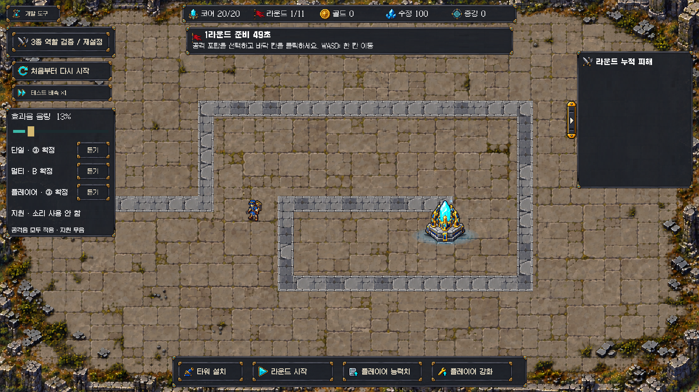

# 승인 공격음 전체 적용 · 2026-10-18

사용자 ‘B안으로 가서 적용하고 싹다 적용해’ 지시로 합의한 모든 공격음을 실제 발사에 연결했다. 앞선 지원 무음 지시는 유지한다.

| 역할 | 현재 실제 적용 | 리소스 경로 |
|---|---|---|
| 단일 | 기존③ Aura_Spawn_1 파생 | CoreGuardian/Audio/TowerShot/03_Aura |
| 멀티 | 포격형② 선명도 **B** ·0.64초 | CoreGuardian/Audio/MultiShot/B_BrighterAttack |
| 플레이어 | 기존③ Aura_Glyph_1 파생 | CoreGuardian/Audio/PlayerShot/03_Glyph |
| 지원 | 무음 | 재생 경로/듣기 버튼 없음 |

개발 도구에서 세 확정음 각각 **듣기**, 공통 **효과음 음량**0~100% 조절. 현재 사용자 저장값0.126900658(표시13%) 보존. 옛 후보 번호를 바꿔도 확정음은 바뀌지 않는다. 미사용 후보 Resources/전환 버튼은 제거했고 원본 팩/과거 청취본/Git 이력은 보존했다.

## 연결 방식

멀티 B 자체에0/85/170ms 세 포신 리듬이 포함된다. 실제 `ProjectileLaunched`의 타깃3개 이벤트를 **포탑별35ms 내 한 번**으로 묶어 세 겹으로 중복하지 않는다. 서로 다른 멀티 포탑은 각자 재생한다. 단일/플레이어 제한은 별도이고 기존4음성 풀·gain0.55/비루프/고정피치1을 유지한다. 효과음 생략 제한은 게임 발사 수/피해/속도를 바꾸지 않는다. 현재 증강 공개 효과음에도 기존 공통 음량 적용을 유지한다.

B는 사용자 청취한 `AudioProduction/CoreGuardian_TowerShot_20261018/multi_artillery_bright/B_BrighterAttack.wav`와 Git blob `1eef60ae86ffc56b4ef763011f203c63b19d9aa3`이 동일하다. PCM/DecompressOnLoad/preload. 원본 샘플/제작/처리 수치는 [B 제작 기록](../../../AudioProduction/CoreGuardian_TowerShot_20261018/multi_artillery_bright/README.md)이 담당한다. 단일/플레이어 승인WAV는 수정하지 않았다.

시작 HEADd3db021/관련 파일 변경없음으로 빈 체크포인트 없이 복구 기준 사용. 전투씬/CSV/모델/패키지/프로젝트설정/맵/그림자/포탑효과/HUD 다른부분/BGM 자료 수정 없음.

## 확인한 범위

- 시작 Unity stopped/pausedfalse/compilingfalse·전투씬1dirtyfalse 확인. 처음 현재 경고1, 컴파일 후 이전 테스트들의UAC0005 경고도 있었으며 마지막 현재값과 구분한다.
- 새 멀티 고정음 검사 미구현 실패 확인 후 실제 러너 **Edit3/3·Play1/1** 통과([Edit](editmode.json), [Play](playmode.json)). 진단보드/재화/적HP·수동Session.Tick 기능QA다.
- 실제 단일 발사1/첫멀티 투사체3/두번째멀티도발사 → 소리는 단일1+멀티별1씩 총3, B음성2개 확인. 여러 타깃 중복 방지와 다른 포탑 누락 방지를 함께 검사했다. 포탑 쿨다운 전의 실제 플레이어 발사03_Glyph 확인. 지원 무음, 미리듣기, 공통 음소거/음량/저장, 4음성 초과 억제, 구후보값 무시, 메뉴/슬라이더 치수 검사.
- 자체 Play에서 실제 Overlay의 단일③/멀티B/플레이어③ 확정/지원무음을 확인했다([라벨/설정](ui_check.json)). 임시TimeScale0 촬영 후1/capture0 복원, 자체Play종료, Assets 임시 캡처 삭제.
- 읽기 전용 코드 리뷰에서 조치가 필요한 결함 없음. 리뷰어는 Unity/청취 검사를 새로 하지 않았다.
- 종료 Playfalse/pausedfalse/compilingfalse·전투씬1dirtyfalse·TimeScale1/captureDelta0([조회](final_state.json)), 컴파일실패false·현재콘솔오류0/경고0. 빌드/실행파일/GitHub push 없음.
- 이 결과는 집중 기능QA다. 사용자 음색 선택과 실제 연결을 완료했지만 정상 다수 전투의 합산음량/클리핑/성능·전체 회귀·사람 플레이·밸런스 통과를 뜻하지 않는다.

이제 확정음으로 실제 플레이하며 반복 청취감을 확인할 수 있다. 추가 사운드는 별도 사용자 작업 지시를 따른다.
