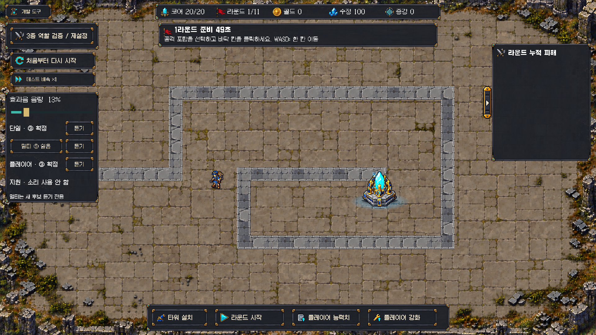

# 플레이어③ 적용 · 지원 무음 · 멀티 새3안

2026-10-18 최신 사용자 선택:

- **단일 포탑:** 이전③ `Aura_Spawn_1` 파생 유지.
- **플레이어:** 이전③ `Aura_Glyph_1`의0.40초 파생을 실제 `Source==Player` 발사에 고정 적용.
- **지원:** 소리 사용 안 함. 런타임 연결/청취 후보/듣기 버튼 없음.
- **멀티:** 기존3안은 미확정이며 새로운3안만 청취 제공. 실제 전투는 아직 무음.

## 새 멀티 비교

| 번호 | 원본 | 새 파생 길이 |
|---|---|---:|
| ① 얼음 파열 | RPG Essentials `13_Ice_explosion_01` | 0.55초 |
| ② 독 분출 | RPG Essentials `46_Poison_01` | 0.50초 |
| ③ 문양 방출2 | Aura Kit `Aura_Glyph_2` | 0.55초 |

앞선 멀티 오라/바람/물결과 다른 원본들이다. 이름은 원본 분류이며 게임에 얼음/독 등의 속성·상태 효과를 추가하지 않는다. 에이전트가 직접 청취해 최적이라고 판정한 것이 아니라 사용자 비교용 후보다. 원본 팩은 [최초 취득/임포트 기록](../magic_cannon_audio_20261018/README.md) 참고.

채팅 비교본 `AudioProduction/CoreGuardian_TowerShot_20261018/multi_round2/MultiNew_123.wav`는 **①두 번 → 긴 쉼 → ②두 번 → 긴 쉼 → ③두 번** 순서. 개별 WAV도 같은 폴더에 있다. Play → 개발 도구에서 멀티 왼쪽 버튼으로 순환/오른쪽 듣기. 단일/플레이어는 확정된③ 고정 듣기다.

## 구현/보존

- `CoreGuardianCombatAudio`의 Player/Single 리소스 경로는 각각 `CoreGuardian/Audio/PlayerShot/03_Glyph`, `CoreGuardian/Audio/TowerShot/03_Aura`로 고정. 두 역할의35ms 재생 제한 타이머를 분리하고4음성 풀은 공유한다. 플레이어 증강 추가 탄환은 소리만 같은 순간에 묶으며 게임 발사/피해/주기 변경 없음.
- 승인 플레이어 WAV를 AssetDatabase.MoveAsset으로 이동했고 Git blob SHA1 `08800d38307191be80e4b07f22c3b326e87ad571`이 전후 동일하다. 단일 WAV도 수정 없음.
- 남은 플레이어 후보와 지원 후보는 Resources에서 제거하고 원본 팩/이전커밋에 보존했다. 원본 팩55 WAV는 수정하지 않았다.
- 새 멀티는 기존 원본 피치 그대로 onset/길이 정리·2ms시작/100ms끝 페이드·peak0.7, 개별 클리핑0([처리 기록](processing.json)). PCM/DecompressOnLoad/preload.
- 생성기 `prepare_multi_round2.py`는 Assets 밖에만 생성하고 선택용3개를 Runtime Multi 폴더에 복사했다. 과거 `prepare_role_auditions.py`도 출력 경로를 Assets 밖 이력용으로 돌려 지원/미사용 플레이어 후보를 다시 가져오지 않게 했다.
- 사용자 음량0.126900658(표시13%) 보존. BGM/CSV/게임 모델/전투씬/패키지/설정/맵/기존 효과·HUD·그림자 작업 변경 없음. 시작HEAD `b0518f4`.

## 실제 확인

- 시작 당시 공유 Play 일시정지 확인, 에이전트가 중단하지 않았다. 사용자 ‘Play 종료했어’ 응답 뒤 실제 stopped/pausedfalse/씬dirtyfalse 확인 후 변경했다.
- 플레이어 고정음 미구현으로 Edit 테스트 실패를 먼저 확인. 구현 후 실제 러너 **Edit3/3·Play1/1** 통과([Edit](editmode.json), [Play](playmode.json)). 진단보드/재화/적HP 주입·수동Session.Tick의 단일 실제 발사와 플레이어 실제 발사03_Glyph, 멀티/지원 무음·지원청취거부·새멀티3개 재생·음량/음소거/중첩/기존 메뉴를 확인했다. 기능QA이며 정상 다수전투/사람 플레이/밸런스 검사 아님.
- 별도 자체 Play에서 현재 단일③/플레이어③/지원무음/멀티새후보와 Overlay 화면을 확인했다. 임시 TimeScale0 촬영 후1/capture0 복원, 자체 Play 종료, Assets 임시 캡처 제거.
- 읽기 전용 코드 리뷰에서 조치가 필요한 결함 없음. 리뷰어는 Unity/청취를 추가 실행하지 않았다.
- 종료 Playfalse/pausedfalse/compilingfalse/전투씬1/dirtyfalse·TimeScale1/captureDelta0([조회](final_state.json)), 컴파일실패false·현재콘솔오류0/경고0.
- 멀티 음색 최종선택·다수 음원 합산 클리핑/믹스/성능·전체회귀·밸런스 검증은 남아 있다. 사용자 플레이어③ 승인을 다른 후보 승인으로 확대하지 않는다.

다음은 새 멀티①②③ 청취 피드백. 지원은 사용자가 재지시하기 전까지 무음이다.
