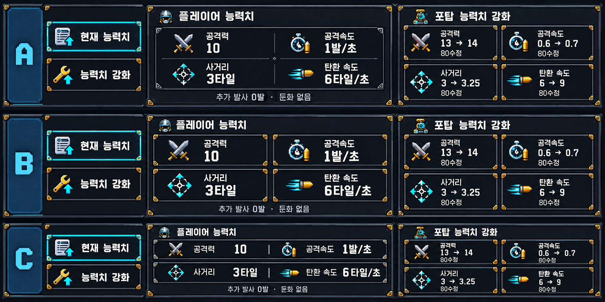

# 능력치 HUD 후속: 탭 글자 수정과 시안

2026-10-17. 수정 전 복구 기준: `0f121ac`. 사용자 최신 요청은 탭 글자 이탈 수정, 능력치별 심볼, 안쪽 강조 패널, 플레이어/포탑 강화 심볼 개선이다.

## 적용한 단순 수정

- `CoreGuardianHudReaction`이 최초 label 위치를 계속 덮어써 세로→가로 탭 배치 전환 시 글자가 아래로 밀렸다. 탭 배치 변경 때 눌림 애니메이션 기준점과 label 크기를 함께 갱신한다.
- 눌림 효과·선택 강조·현재/구매 흐름은 유지한다. 새 패널·새 심볼은 아직 제품에 적용하지 않았다.
- 자체 Play에서 `VerifyTabText.cs` 실행: 수정 전 PlayerSpecTab 아래 여백 검사 실패 → 수정 후 플레이어 현재/강화/현재, 포탑 현재/강화 모두 통과. 콜백 및 진단 설치를 사용한 기능 QA이며 사람 플레이/밸런스 측정/전체 회귀가 아니다. [실패 원본](tab_text_red.json), [통과 원본](tab_text_green.json).
- [실제 Overlay 포함 적용 화면](tab_text_fixed.png). 포탑 선택/진단 재화는 검사용 런타임 상태다. 자체 Play 종료. 씬·원본 리소스·병행 애니메이션/VFX 코드 미수정.

## 검토용 시안 — 미확정

- A: 한 장의 안쪽 패널에 능력치 4개를 2×2 배치. 안쪽 선으로만 구분해 장식 밀도를 낮춘다. 우선 추천.
- B: 각 능력치를 별도 카드로 구분. 수치 강조가 가장 강하지만 테두리가 많다.
- C: 얇은 두 줄 패널에 2개씩 배치. 전투 시야를 우선하는 압축형.
- 공통: 공격력=교차 검, 공격속도=시계+탄환, 사거리=바깥 화살표 조준점, 탄환 속도=직선 탄환+잔상. 공격속도와 탄환 속도의 중복 심볼을 없앤다.
- 현재 능력치 탭=능력치 목록, 강화 탭=렌치+위 화살표. 플레이어/포탑 모두 같은 행동에는 같은 탭 심볼을 쓰고 제목의 헬멧/포탑으로 대상 구분. 강화 구매 항목은 해당 능력치 심볼을 공통 적용한다.
- 사용자 첨부 실제 HUD를 참조하여 imagegen으로 생성한 외형 비교 이미지다. 실제 Unity 캡처가 아니며 좌우는 현재 능력치와 강화화면의 비교용 병렬 표시다. A/B/C 글자 기둥은 비교표 표식으로 게임에는 넣지 않는다. 이미지의 수치·비용은 배치용 예시이며 밸런스 변경안이 아니다. 생성 이미지의 픽셀 격자/최종 크기/폰트 일치를 승인한 것으로 보지 않는다. 선택 후 기존 실제 폰트와 런타임 수치로 구현한다.

## 남은 작업

사용자 배치 선택 → 실제 픽셀 크기에 맞춘 심볼 정리 → 플레이어/포탑 현재·강화 공통 적용 → 실제 크기 Overlay/입력/접기 유지 확인. 확정 피해 HUD, 빈 바닥 첫 클릭 접기/다음 선택 해제, 설치 후 스펙 자동 펼침 생략은 유지한다. 빌드/실행파일 실행/push 없음.
