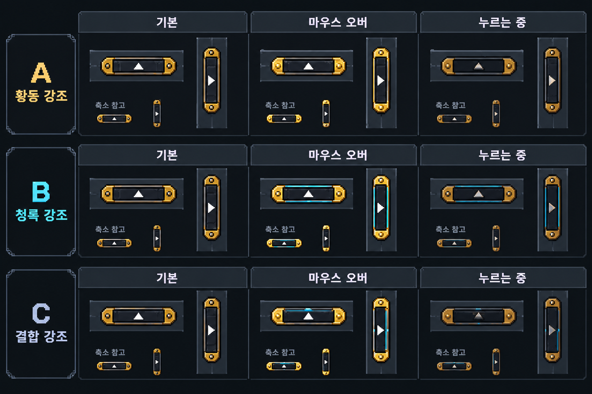
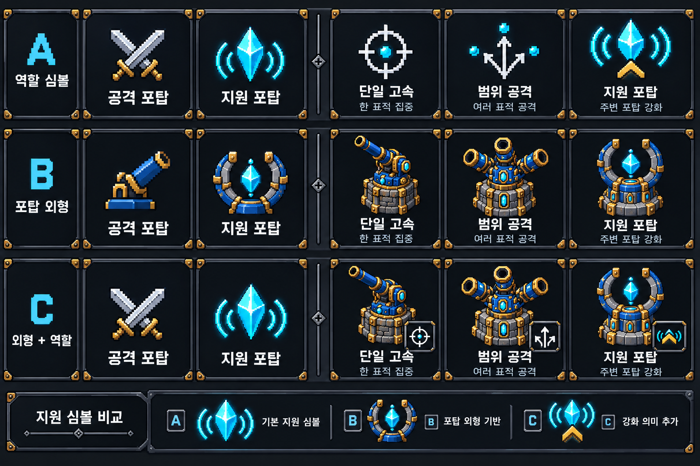

# 접기 반응·지원/설치 포탑 심볼 시안

2026-10-17. 사용자는 Unity 작업 없이 시안만 요청했다. 게임 코드/Assets/씬/Play/Notion 규칙은 변경하지 않았고 Unity API도 호출하지 않았다. 최신 확인 HEAD `64f0b26`; 능력치 A안 적용은 유지한다.

## 확인 근거와 범위

- 이번 사용자 첨부4장을 직접 확인했다. 작은 손잡이, 공격/지원 분류, 개별 지원/단일/범위 설치 항목을 기준으로 삼았다.
- 소스 읽기에서 SmallHandle은 공통 버튼 반응 컴포넌트 없이 기본 Button을 사용하고, 피해 손잡이는 색 Tint를 사용하고 있음을 확인했다. 실제 현재 Hover 이벤트 수신/포인터 위치/런타임 색 변화는 검사하지 않았으므로 ‘이벤트가 전혀 없다’로 원인을 확정하지 않는다.
- 포탑 원본 Source/tower_single.png, tower_multi.png, tower_support.png를 직접 확인했다. 긴 포신 하나/벌어진 포신3개/양쪽 기둥 사이 수정이라는 기존 외형을 구분점으로 사용한다.

## 손잡이 반응 비교

- A: 황동 끝장식 밝기 강조. 기존 외형 변화가 가장 적지만 작은 화면에서는 차이가 약할 수 있다.
- B: Hover에서 얇은 청록 테두리, 누를 때 어두워짐과 화살표 안쪽 이동. 기존 버튼 선택 강조와 연결하기 쉽다. 우선 추천.
- C: 황동 밝기와 짧은 청록 포인트 결합. 장식 밀도가 높다.
- 기존 얇은 손잡이 실루엣·접기 방향을 유지하고 전체 크기 확대/큰 글자 탭으로 바꾸지 않는다. 가로/세로·접힘/펼침 모두 같은 반응 체계를 적용하는 제안이다.

## 분류/개별 포탑 심볼 비교

- A 역할 심볼: 공격=교차 검, 지원=파동을 내보내는 수정, 단일=표적1개 조준점, 범위=3갈래 화살표, 지원 개별=수정 파동+상승 표시. 작은 아이콘에서 역할을 구분하는 데 우선 추천.
- B 포탑 외형: 원본 긴 포신/세 포신/양팔 수정 형상을 축약한다. 실제 설치물을 연결하기 좋지만 작은 크기의 디테일 정리가 필요하다.
- C 외형+역할: B의 축약 외형과 작은 역할 배지 결합. 정보는 많으나30px 내외에서는 복잡해질 수 있다.
- 분류와 개별 목록을 비교표에 나란히 보여준 것이며 게임에서 모두 동시에 표시하거나 설치 패널 구조를 변경하자는 제안은 아니다. 텍스트 이름과 기존 비용/비활성 정보는 유지한다.
- 지원은 주변 포탑 공격력 강화 역할이다. 체력 회복 십자/방패를 쓰지 않는다. 재화 수정과 구분되도록 파동 또는 양팔 구조를 동반한다. 기존 피해 HUD의 확정 역할 심볼을 교체하는 범위로 확대하지 않는다.

## 제작·다음 단계

두 이미지는 imagegen built-in으로 사용자 화면과 기존 포탑 원본을 참조해 만든 **미적용 생성 시안**이다. 확대/축소 참고는 디자인 비교이며 실제 최종 픽셀 크기·엔진 Hover 검증이 아니다. 사용자 선택 후 원래 HUD 크기에 맞춘 픽셀 정리와 동작 구현을 진행한다. 새 Unity 검증·컴파일·게임 빌드·실행파일·push는 하지 않았다.

프롬프트 요약: 손잡이는 기존 얇은 금속 몸체/황동 끝/흰 화살표를 유지한 A황동/B청록/C결합의 기본·Hover·Pressed 가로/세로 비교, 포탑은 기존 원본3종을 기준으로 A역할/B축약외형/C외형+배지의 공격/지원 분류와 단일/범위/지원 개별 목록 비교. 두 보드 모두 금속/황동/청록 픽셀 스타일, 읽는 이름을 함께 표시하며 시안의 라벨 기둥은 게임에 넣지 않는다.
