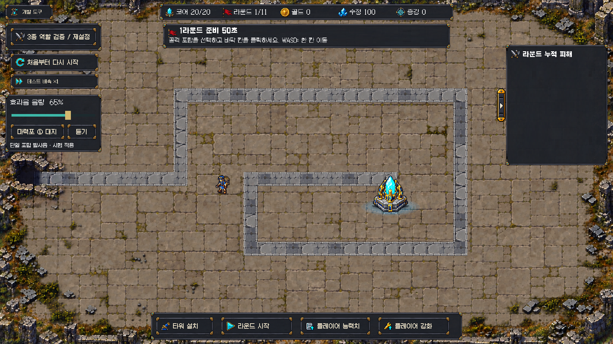

# 마력포 사운드 시험 적용 · 2026-10-18

사용자가 임포트한 두 무료 팩에서 단일 포탑 발사음 후보3개를 짧게 편집해 실제 발사에 연결했다. 최종 음색 선택 전의 시험 적용이다. 이전 합성3안과 실총 계열은 사용자 거부로 사용하지 않는다.

## 사용 방법과 후보

Play → **개발 도구 → 마력포 후보 버튼**을 눌러 ①②③ 순환 → **듣기**로 미리 재생한다. 선택한 후보는 단일 포탑의 실제 발사에도 적용된다. 초기 시험값 **①대지/효과음65%**, 음량과 후보는 PlayerPrefs에 저장한다. `효과음 음량`0~100%는 새 발사음과 기존 증강 공개 효과음에 적용되며 BGM 제작 자료는 수정하지 않았다.

| 후보 | 원본 | 시험본 길이 |
|---|---|---:|
| ① 대지 (초기값) | RPG Essentials `30_Earth_02` | 0.70초 |
| ② 화염 | RPG Essentials `04_Fire_explosion_04_medium` | 0.60초 |
| ③ 오라 | Aura Kit `Aura_Spawn_1` | 0.75초 |

분류는 원본명과 파형/길이를 기준으로 했다. 에이전트가 직접 청취해 음질/타격감/마력포 정체성을 승인한 것이 아니다. 긴 원본 잔향을 줄이고 시작2ms/종료120ms 페이드와 peak0.7의 레벨 정리만 했다. 합성음/총성 추가·피치 변경 없음. 원본 WAV 수정 없음. 새 파생 WAV는 `Assets/Resources/CoreGuardian/Audio/TowerShot`에 있다.

## 소스와 보존

- [RPG Essentials Sound Effects - FREE!](https://assetstore.unity.com/packages/audio/sound-fx/rpg-essentials-sound-effects-free-227708): `Assets/Leohpaz/RPG_Essentials_Free`, 오디오48개.
- [FREE Magic Aura Construction Kit](https://assetstore.unity.com/packages/vfx/particles/spells/free-magic-aura-construction-kit-154136): `Assets/AS_Magic_Aura_Construction_Kit_FREE`, 오디오7개. 팩의 ReadMe PDF와 다른 원본 리소스도 보존한다.
- 사용자가 약관 동의 진행을 승인한 뒤 두 팩을 계정에 취득했고, 에디터 임포트는 사용자가 직접 완료했다. 연결 시작 HEAD `27b92d8`, 두 팩 원본 체크포인트 `1523eb7`.
- 데모 씬 `.unity`와 `.meta`는 동일 바이트 사본을 `AudioProduction/VendorSceneArchive`에 보관하고 AssetDatabase로 Assets에서 제거했다. 전투 씬 하나 유지, 데모 VFX/재질은 전장에 적용하지 않았다.
- 처리 스크립트: `AudioProduction/CoreGuardian_TowerShot_20261018/prepare_imported_magic.py`. 원본 SHA256·길이·peak·클리핑0 근거는 [처리 결과](audio_processing.json).

## 구현 범위

- `CoreGuardianCombatAudio`: 런타임 생성, 실제 `Session.ProjectileLaunched` 중 Single 포탑만 연결. 플레이어/멀티/지원 음원은 미적용. 2D/고정피치1/비루프/최대4음성, 전체 최소간격35ms. 밀집 발사는 일부 소리를 생략할 수 있으며 투사체/피해/발사 수는 변경하지 않는다.
- `CoreGuardianSoundSettings`: 볼륨/후보만 로컬 저장. 초기65%, NaN/Infinity 안전 처리. 발사음 개별 gain0.55, 기존 증강 공개음 자체 gain0.65는 보존하고 공통 효과음 음량을 곱한다.
- `CoreGuardianHud.Sound`: 기존 개발 메뉴에만 표시. 배치 모드/증강 모달은 기존 HUD 차단 정책을 따른다. 소리 미리듣기는 실제 공격을 만들지 않는다.
- 전투씬 파일·게임 모델·CSV·패키지·프로젝트설정 변경 없음. 포탑 접지/반동/국소발광·기존 HUD·후처리·오브젝트 강조·맵·기존 BGM 자료 보존.

## 실제 검증과 한계

- 먼저 새 Edit 테스트2개가 미구현으로 실패하는 것을 수동 NUnit 호출로 확인했다. 이후 실제 러너 **EditMode2/2** 통과. 클립3개 실데이터·끝 페이드·음량 저장/범위/비정상값 검사. 처음0건 반환은 통과로 세지 않았다.
- 실제 러너 **PlayMode1/1** 통과([결과](playmode_result.json)). 진단 재화/보드/적HP 주입, 수동 Session.Tick으로 실제 단일/멀티 투사체 생성. 단일만 발사음, 재구성·후보3개·4음성 초과 억제·정지/재활성·슬라이더 음소거/37% 실소스 음량·메뉴 열기/닫기·막대8px/손잡이28px 확인. 사람 입력/청취/밸런스 검사가 아니다.
- 첫 UI 검사는 기존 HUD의200ms 갱신을 기다리지 않아 실패했다. 대기 반영 후 통과했다. 실제 화면에서 발견한40px 막대/패널 밖 늘어남은 컨테이너 분리로 수정하고 재현 테스트 실패→통과를 확인했다.
- 별도 정상 Play: 기본 재화100으로 Single을 실제 구매(2,9), 기본 rate1.2/range3.5 유지. 자연 출현 적8, 발사음25회/억제0, Diagnostic=false 확인([기록](normal_launch.json)). API 설치/시작 콜백을 사용한 집중 기능 확인이며 사람이 직접 플레이한 기록이 아니다.
- 자체 Play를 종료/재시작해41%/후보③와 UI41% 복원 확인([기록](restart_check.json)), 이후 시험 환경설정 키를 원래 미설정 상태로 복구했다. 따라서 현재 초기값①/65%다.
- 코드 리뷰는 읽기 전용으로 시행했고 변경 범위에서 조치가 필요한 결함을 찾지 않았다. 리뷰어는 Unity 검사/청취를 수행하지 않았다.
- 종료 **Play=false/paused=false/compiling=false·전투씬1·dirty=false·TimeScale1/captureDelta0**([조회](final_editor_state.json)), 컴파일실패false·현재 콘솔 오류0/경고0. 자체 Play/시간/임시 캡처 에셋 복원.
- 직접 청취·사용자 음색 선택·다수 전투 믹스/합산 클리핑/성능·전체 회귀·밸런스 검증은 남아 있다. 기존 BGM/밸런스 미추적 자료와 `font_tools_vendor` 삭제 표시는 커밋에서 제외했다.

다음은 사용자가①②③을 들어보고 주력 음색을 선택하는 것이다. 다른 핵심 효과음은 후보 선택 후 같은 방향으로 진행한다.
