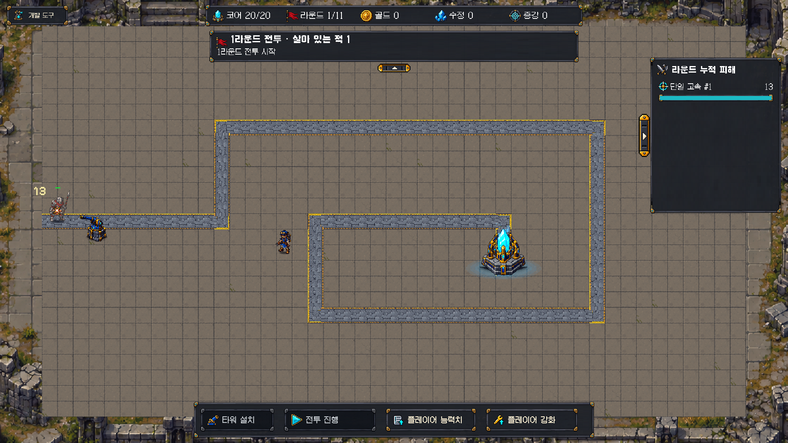

# B안 방치된 요새 — 메인 바닥·2D 배경 적용

2026-10-17 (Asia/Seoul). 사용자 “B안으로 진행해서 적용해 메인그라운드랑 백그라운드 잘 이어지게 노력해” 지시에 따른 적용이다. 복구 기준은 `c2deb56`이며 시작 당시 font_tools_vendor 접근 표시 외 추적 파일 변경은 없었다. 다른 작업의 미추적 자료는 보존했다.

## 구현 범위

- 현재 전투 씬 하나에서 기존 바닥 1,125칸과 코어 바닥 1칸의 **표시 타일만 교체**했다. 논리 보드는45×25/0.6, 타일 좌표·변환·색·경로·코어 위치·기존 이동/설치 참조를 유지한다. 기존 회색 바닥/경로/유닛 원본을 덮어쓰지 않았다.
- `Assets/Art/Environment/AbandonedFortressB/StoneSlabs_B_2x2.png`: 생성한4종 석재 시트. Sprite Editor 데이터 제공자의 편집 가능 여부를 확인해4분할하고, Point/압축 없음/밉맵 없음으로 등록했다. 원본1254×1254 → 임포트64×64, 실제 각 스프라이트32×32/PPU53.333332/폭0.6이다. 787칸은 기본,250칸 모서리 마모,62칸 균열,26칸 이끼로 배치해 바닥 질감을 절제했다. 각 한 칸의 줄눈을 유지한다.
- 같은 폴더의 `Stone_B_0~3.asset`과 `StoneFloor_B.mat`를 사용한다. 바닥/코어 바닥 전용 재질의 `_Color`1.05/1.045/1.035로 주변 배경의 석재 톤에 맞췄다. 기존 공용 재질과 카메라 색보정은 수정하지 않았다. 발광 효과가 아니다.
- 씬의 `CoreGuardian_MapArt_B/Background_Ruins_VisualOnly`는 별도2D SpriteRenderer다. sortingOrder=-20, 기존 공용 Unlit 재질, 충돌체·런타임 스크립트 없음. 현재 카메라 영역보다8% 넓게 표시해 메인 바닥 경계가 성벽을 자르는 현상을 줄이고 바깥에 석재 연결 구간을 남겼다. 카메라가 아니라 **배경 아트의 배율**만 조절했다. 현재1920×1080 화면 끝까지 채운다.
- `CourtyardBackground_B.png`는 선택한B 시안에서 길·기술병·코어·빛/그림자를 제거한 환경 원본이다. 게임 경로·개체는 기존 실제 리소스로 계속 표시한다. 배경을 이동/설치 가능 영역으로 추가하지 않는다. 내부 높이 장식/장애물·새 경로·추가 조명/입자 없음.
- 적용은 [ApplyMapB.cs](ApplyMapB.cs)의 Unity 에디터 API와 후속 에디터 재질/배경 배율 조정으로 수행했다. 씬 YAML/메타 직접 편집 없음. 이 도구는 최초 적용용이며 기존 B 적용 씬에서 재실행하면 중복 생성 방지를 위해 중단한다. 초기 실행 보고서 [applied_setup.json](applied_setup.json)은 배율/재질 미조정 시점이며, **현재값은 [final_setup.json](final_setup.json)**이다.

## 이미지 제작과 접합부 조정

built-in image_gen 편집 모드를 사용했다. 선택한B 이미지에서 길·개체를 제거하고 중앙은 조용한 석재, 주변은 같은 석재·낮은 폐벽·먼지·올리브 이끼로 연결하도록 요청했다. 타일 시트는 같은 팔레트로 기본/마모/이끼/균열4종, 내부 세분화 없는 정사각 한 장씩2×2, 단순 픽셀·얇은 줄눈을 요청했다. 출력 원본은 위 Assets 경로에 보존한다. Unity 임포트·슬라이싱 외 별도 비트맵 편집은 하지 않았다.

첫 화면에서 메인 영역이 외곽 성벽을 자르는 점을 확인했다. 배경 생성 수정안도 비교했으나 재후처리된 느낌의 대비/색 차이가 커 미채택했고 프로젝트의 미사용 수정안은 에디터 API로 제거했다. 최초 환경 원본을8% 넓히고 바닥 전용 재질을 맞춘 상태를 최종 사용한다. 새 배경과 메인 줄눈이 모든 접점에서 수학적으로 일치한다는 뜻은 아니며, 최종 연결감·아트 선호는 사용자 화면 피드백 대상이다.

## 실제 확인과 한계

- [적용 전 Edit 화면](before_edit.png) / [적용 후 Edit 화면](applied_edit.png): 같은1920×1080 실제 게임 카메라, 배치·카메라 변경 없음. 런타임 HUD 없는 상태다.
- [적용 전 상태 스냅샷](before.json)과 [검증 도구](VerifyMapB.cs)로6개 Tilemap 총1,312개 타일 좌표/변환/색을 대조했다. 바닥/코어 바닥 외 타일 리소스·기존 렌더러 설정, 기존6루트 Transform, 카메라/URP 설정, 게임/선택·입자·강화 컴포넌트와 이동 설정이 보존됐다. 바닥/코어 바닥 재질 변경만 예외로 허용했다. [최종 대조](final_invariants.json) passed=true, scene dirty=false.
- [실제 준비 HUD](applied_hud_ready.png) / [설치 표시](applied_hud_installation.png) / 위 [전투 HUD](applied_hud_combat.png): ScreenSpaceOverlay가 포함된 합성 GameView다. [검사 도구](CaptureMapB.cs)는 자체 Play에서 Reload/Start HUD 콜백·정상 TryStep4방향 이동/복귀·기존 재화100의 단일 포탑 구매·경로 설치 거부·자연 피해13을 확인했다. 설치 표시1,125개(초록1,032/빨강93)를 확인했다. 적/돈/피해 주입이나 강제 처치는 없으며 Diagnostic=false다. 캡처 때만 TimeScale0으로 고정하고 finally에서1/captureDelta0으로 복원했다. 카메라 변경·임시 입력장치 없음. [실행 결과](runtime_visual_qa.json).
- 이는 **API/HUD 콜백 기능·시각 QA**다. 직접 마우스/키보드 입력의 사람 플레이, 전체 EditMode/PlayMode 스위트, 여러 해상도, 다수 후반 전투/성능, 밸런스 실측은 이번에 하지 않았다. 원래 보행·HUD·효과의 전체 회귀 통과나 최종 자연스러움 승인으로 확대하지 않는다.
- 종료: 자체Play 종료/pausedfalse, 전투 씬1/dirtyfalse, compilingfalse/compilationFailedfalse, TimeScale1/captureDelta0. 현재 콘솔 groundTruth 오류0/경고0. 카메라HDRfalse/posttrue·색보정35/12/-0.45EV 유지. 선택 초록2px·강화0.8초·입자0.025/0.1/4/12는 적용 전후 컴포넌트 동등성으로 확인했다.
- 빌드/실행파일/push/새 씬/밸런스·사운드·Notion 수정 없음. 원본 아트/CSV/이동/전투/HUD 코드는 변경하지 않았다.
- 별도 읽기 검토자가 씬 diff·상태 대조·실제 적용/전투 화면을 검토해 조치할 문제 없음을 보고했다. 검토자는 파일/Unity 상태를 변경하거나 검사를 실행하지 않았다. 이 검토 역시 사용자 최종 아트 승인을 대신하지 않는다.

## 다음 확인

사용자가 실제 화면에서 B안 바닥과 외곽 배경의 연결감·질감 밀도를 확인한다. 추가 조정도 시각 범위에서 진행하고, 밸런스는 사용자 별도 일정까지 보류한다. 기획 상세 소유 문서는 [앞선 조사](../map_decoration_review_20261017/README.md)의 링크를 따른다.
