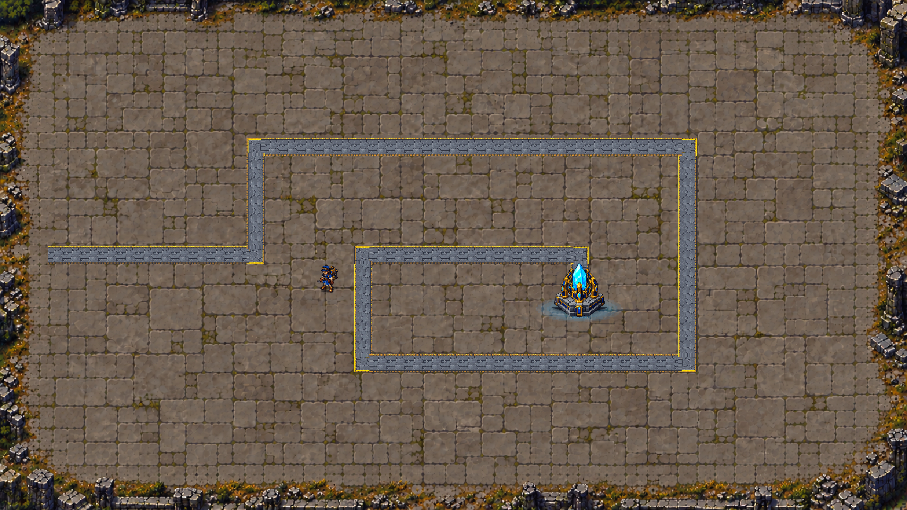

# 자연석 1안 — 바닥·배경 연속 표시 적용

2026-10-17 (Asia/Seoul). 사용자 “1안으로 배경이랑 타일 적용”, “굳이 균등할 필요는 없는 것 같다” 지시를 반영했다. 복구 기준 `0070a76`, 시작 당시 font_tools_vendor 접근 표시 외 추적 파일 변경 없음. 초기 B 반복32px 바닥과 미적용 시안 단계는 이 후속 구현으로 대체된다.

## 현재 구현

- 선택 원본: [1안](../map_B_floor_scale_proposals_20261017/01_same_layout_larger_stone.png). 크기와 줄눈이 다른 자연석·작은 이끼·마모와 외곽 폐허가 한 표면으로 이어진다. **보이는 돌판의 줄눈을 논리 타일 한 칸에 강제로 맞추지 않는다.**
- `Assets/Art/Environment/AbandonedFortressB/NaturalCourtyard_01_ClearBorder.png`를 기존 `CoreGuardian_MapArt_B/Background_Ruins_VisualOnly`의 한 장짜리2D 스프라이트로 표시한다. Point/압축없음/밉맵없음/FullRect, sortingOrder=-20, 기존 공용 Unlit 재질. 초기B의8% 아트 확대는 제거하고 현재 카메라 프레임에 맞춘다. 카메라 변경이 아니다.
- `Ground_Prototype`/`Core_Prototype`의 TilemapRenderer는 false다(Core_Prototype은 이전부터 false). 타일·Tilemap·게임 참조는 그대로 남아 이동·설치 논리를 담당한다. 초기4변형 바닥 리소스/전용 재질은 보존하지만 화면 위에 덮지 않는다.
- 실제 길·코어·플레이어·포탑·몬스터는 기존 원본과 기능을 그대로 사용한다. 생성 이미지에 그려진 길·개체를 게임 대상으로 대체하지 않는다. 보드45×25/0.6·경로·충돌·이동/설치 규칙·게임 수치·카메라·HUD 변경 없음.2/3안의 전장 압축은 적용하지 않았다.
- 설치 모드의 기존 초록/빨강 칸 표시는 논리 칸 위에 그대로 표시한다. 평상시 자연석 줄눈과 설치 칸의 경계는 서로 다를 수 있다. 장식이 이동/설치 가능 칸을 추가하지 않는다.

## 이미지 제작과 적용

built-in image_gen 편집으로 선택한1안에서 길/황동 경계·플레이어·코어·해당 그림자/빛만 제거하고 같은 자연석으로 메우도록 요청했다. 첫 정리 원본은 `NaturalCourtyard_01.png`에 보존했다. 실제 설치 표시에서 외곽 높은 벽/잔해가 설치 가능 영역과 겹쳐 보이는 점을 확인해, 바닥 돌판 비율은 유지하면서 높은 외곽 장식만 화면 가장자리로 정리한 `NaturalCourtyard_01_ClearBorder.png`를 최종 사용한다. 배경 확대12% 임시 비교는 채택하지 않았다.

[ApplyNatural01.cs](ApplyNatural01.cs)와 에디터 API로 임포트/스프라이트 교체/바닥 렌더러 비활성화/씬 저장을 수행했다. 씬 YAML/메타 직접 수정, 새 런타임 스크립트/충돌체/씬 생성 없음. 원본 PNG/기존B 리소스 보존. 현재값은 [final_setup.json](final_setup.json)을 따른다.

## 확인한 결과

- [검증 도구](VerifyNatural01.cs)는 기존 B 적용 전 `../map_B_applied_20261017/before.json`과 대조한다.6개 Tilemap1,312개 칸의 좌표·변환·색, 비바닥 타일 원본, 기존 루트 Transform, 이동/게임/선택·강화·입자 컴포넌트, 카메라/URP 설정 보존 확인. 예외는 바닥 재질과 바닥 렌더러 가시성이며, 현재 바닥 렌더러false와 최종 스프라이트를 별도 확인한다. [최종 대조](final_invariants.json) passed=true/dirtyfalse. 경계 검사는 프레임 끝의 부동소수 오차에0.001단위 허용 오차를 사용한다.
- [실제 준비 HUD](applied_hud_ready.png) / [설치 표시](applied_hud_installation.png) / [전투/숫자](applied_hud_combat.png): Overlay 포함 실제1920×1080 GameView. [기존 도구를 재사용한 QA](CaptureNatural01.cs)에서 자체Play·Reload/Start HUD 콜백·TryStep4방향 복귀·설치1,125개(초록1,032/빨강93)·경로 설치 거부·기존 재화100 단일포탑 구매·자연 피해13을 확인했다. 재화/적/피해 주입 없음, Diagnostic=false. [결과](runtime_visual_qa.json).
- 캡처 시 TimeScale0을 잠시 사용하고 finally에서1/captureDelta0을 복원했다. 카메라/임시 입력장치 변경 없음. 최종 외곽 수정 뒤 다시 촬영한 화면이 위 현재 파일이다. 자체 Play 종료/pausedfalse/씬1·dirtyfalse/compilingfalse/실패false·현재 콘솔 오류0/경고0. 카메라HDRfalse/posttrue·대비35/채도12/노출-0.45 유지.
- 독립 읽기 검토에서도 조치할 문제 없음. 설치 표시가 높은 잔해와 겹치지 않고 길/개체/HUD/피해 숫자가 구별되는 화면을 확인했다. 사람 직접 입력/플레이·전체 자동 스위트·다수 후반 전투/성능·다른 해상도·밸런스 측정/최종 아트 승인과는 구분한다.
- 빌드/실행파일/push/밸런스·사운드·Notion 변경 없음. 다른 작업의 미추적 자료/font_tools_vendor 접근 표시는 보존했다.

다음은 사용자 실제 외형 피드백이다. 별도 지시 없이 균등 반복 타일을 다시 표시하거나 전장2/3안/카메라·보드·전투 수치를 적용하지 않는다.
