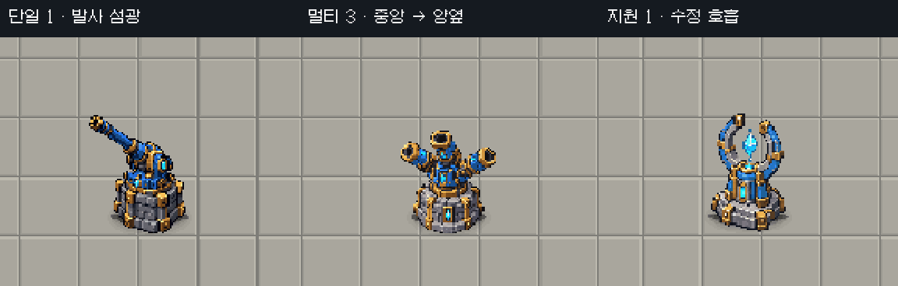

# 포탑 국소 발광 적용 — 2026-10-17

사용자가 9안 비교 후 “추천조합대로 진행해”로 **단일1 / 멀티3 / 지원1** 적용을 승인했다. 수정 전 복구 기준 `e0ce72d`. 병행 문서 작업으로 종료 전 HEAD는 `3d00586`까지 진행됐으며 그 변경은 보존했다. [선택 전 9안](../tower_glow_options_20261017/README.md).

## 적용

- 단일1: 실제 발사 순간 짧은 청백색 섬광, 약0.16초 감쇠.
- 멀티3: 실제 발사마다 중앙에서 양옆으로 순차 점등, 최대 약0.24초 내 복귀.
- 지원1: 수정에 약한 호흡, 실제 버프 범위 안 공격 포탑 발사 시 반응. 자체 투사체를 추가하지 않는다.
- 빠른 연사는 기존 반동 길이에 맞춰 점등 시간도 축소한다. 공격 횟수·탄환·대미지·공격 속도 데이터는 변경하지 않는다.

`CoreGuardianUnitAnimation`의 기존 Fire/Present 경로에 `CoreGuardianTowerGlow`를 연결했다. `CoreGuardianCombatAnimation`의 실제 ProjectileLaunched/지원 범위/한 프레임 다중 탄 합치기를 그대로 재사용한다. 원본 몸체와 반동 Fixed/Moving 각각에 작은 MeshRenderer를 붙여 원본 재질·도트·스프라이트를 보존한다. 원본 청색 영역 마스크와 국소 가산 발광만 사용한다. 비활성화 시 숨기고 파괴 시 런타임 메쉬·재질도 정리한다.

카메라 후처리/HDR/Global Light/저장 씬/포탑 프리팹/기존 탄·반동은 변경하지 않았다. 몸 피격·코어 효과·피해 숫자·병행 HUD도 보존했다.

## 검증

- 새 EditMode: 구현 전3/3 실패(발광 레이어 없음) → 구현 후3/3 통과. 실제3종 프리팹 Fire 즉시 반응·Fixed/Moving 추종·복귀·고속 점등 단축·비활성화·원본 sprite/material/color 유지.
- 전체 **EditMode107/107 통과**: [결과](edit_result.json).
- 집중 **PlayMode1/1 completed 통과**: [결과](play_result.json). 실제 씬 초기화 후 진단 재화/별도 보드/고HP 타깃·20회/초를 주입한 기능 QA다. 단일·멀티 실제 Session 발사와 다음 프레임 재발사·멀티3발 이상·근거리 지원 반응·범위 밖 지원 무반응·지원 자체 탄0·점등 복귀를 확인했다. 정상 구매/사람 플레이/밸런스 실측이 아니다.
- 전체 PlayMode는 **completed 0건**: [결과](full_play_result.json). 통과로 세지 않는다. 재개 직후 컴파일 중 최초 검사0건도 통과가 아니다.
- 종료 [상태](final_status.json): 전투 씬1, dirty=false, Play=false, compiling/compilationFailed=false, TimeScale1, captureDelta0, HDR/post=false, 새 셰이더 오류0, 현재 콘솔 오류0·경고0. 자체 Play 종료 확인. 저장 씬 SHA256 `57D5EAFBE20D99627970F8CF1EA07B95DA34FEA48B2E53AB79BC0DB6CBFE3A65` 동일.

## 적용 코드 시각 확인

원본 포탑 + 실제 적용 UnitAnimation/셰이더를 현재 씬 바닥 위 임시 카메라로 캡처했다. **Fire를 진단 시계로 호출한 격리 시각 확인**이며 정상 전투 영상이 아니다. 실제 투사체와 ScreenSpaceOverlay HUD는 포함하지 않았다. 기존 게임 카메라의63.52941픽셀/월드 배율로48프레임/20fps 렌더 후 nearest2배 확대했다. 임시 씬/카메라는 제거했다. [코드](CaptureSelected.cs), [상태](capture.json), [인코딩](encode.py).

기능 적용과 사용자 최종 외형/자연스러움 승인은 별도다. 정상 배치 다수 포탑 전투의 HUD/숫자 가독성·중첩 강도·성능 계측은 남아 있다. 포탑별 작은 별도 렌더러/재질을 추가하므로 측정 없이 성능 비용이 없다고 표현하지 않는다. 빌드/실행파일/GitHub push는 수행하지 않았다.
