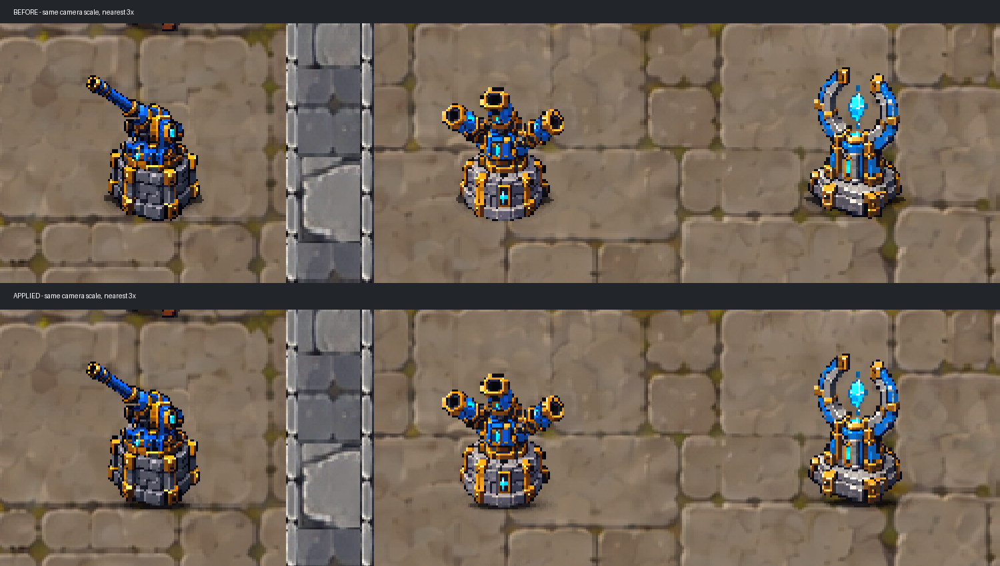

# 모든 포탑 접지감 강화 — 2026-10-18

사용자가 좁고 진한 접촉부·받침 하단 명암·짧은 우하향 그림자 시안을 선택하고 모든 포탑 적용을 지시했다. 복구 기준은 변경 전 게임 에셋이 깨끗했던 `e556c084556507de78d61f61f0fa135f91834088`이다. 기존 미추적 자료와 font_tools_vendor 접근 문제 표시는 건드리지 않았다.

## 적용

- `CoreGuardianUnitAnimation`의 기존 실제 포탑 생성/애니메이션 연결에서 `CoreGuardianTowerGrounding`을 만든다. 단일·멀티·지원 모두 대상이며 설치 미리보기에는 연결하지 않는다.
- 기존 그림자 중심의 논리 원점 대신 원본 본체 밑면과 병종별 앞쪽 접촉 중심을 사용한다. 원본 한 픽셀의 월드 크기를 기준으로 접촉 높이4px/알파.82, 주변 높이11px/알파.20, 투사 높이7px/우측4px/알파.30이다. 기존 위치가 맞지 않던 발 복제 `바닥 밀착선`은 런타임 포탑에서만 숨긴다.
- 하단5개 원본 픽셀 행에 최대46%의 어두운 명암을 별도 원본 알파 마스크 메시로 겹친다. 원본 PNG·고정/반동 파생 스프라이트·프리팹·원본 재질/색/Transform은 수정하지 않는다.
- 하단 명암은 `2D Sprite`의 형제 `TowerBaseShade`이며 본체 합집합·강화·선택선 마스크에 포함하지 않는다. 기존 발광·반동과 분리된 정적 받침 표현이다. 깊이정렬 뒤 실행(order100)하고 본체+2로 배치한다. 개체 강조450/선택500보다 앞선다.
- 코어/플레이어/몬스터·배경/길/땅굴·HUD·전투 데이터·설치 규칙·카메라 후처리는 변경하지 않는다. 관련 표현의 기존 상세 규칙은 각 담당 문서가 계속 관리한다.

## 실제 화면

위는 이전 그림자, 아래는 적용 그림자다. 현재 씬 바닥에 원본 포탑3종을 임시 생성하고 실제 적용 코드를 호출한 **격리 Edit 시각 확인**이다. 실제 카메라와 같은 위치/범위·1920×1080·63.52941px/월드, 동일 crop을 nearest3배 확대한 비교다. 수동 idle Present이며 사람 플레이·정상 전투·HUD 캡처가 아니다. 기존 색보정은 복제 카메라에 연결했다. 임시 루트/카메라는 제거하고 씬1/dirtyfalse를 확인했다. [원래 화면](before_edit.png), [적용 화면](applied_edit.png), [촬영 수치](capture.json), [재현 스크립트](CaptureGrounding.eval.cs).

자체 Play의 실제 설치·Overlay 화면도 확인했다: [준비/3종 설치](applied_hud.png), [자연 몬스터 대상 발사](applied_hud_combat.png). 세 종류를 함께 보기 위해 진단 수정1000만 주입했고 정상 `Place` API로 각100을 지출했다. 촬영 시 TimeScale0, 게임 카메라 줌/위치는 변경하지 않았다. 정상 인게임 위치·효과와 B②강조를 확인한 화면이며 사람 키보드/마우스 플레이는 아니다.

## 검증과 한계

- 신규3종 계약의 수동 NUnit 호출은 구현 전3건 모두 명암 레이어 없음으로 실패 → 구현 후3/3 통과했다. 접촉 밑면 위치, 짧은 투사 그림자, 원본 리소스/위치 유지, 발사 후 고정과 정렬·본체 마스크 밖 구조를 검사한다.
- 기존 포탑 발광3건·B②강조3건을 포함한 집중 **수동 NUnit 메서드 호출9/9 통과**: [결과](focused_assertions.json). 정식 EditMode 도구 실행은 최초0건 반환이었으므로 자동 러너 통과/전체 회귀로 표현하지 않는다.
- 실제 씬 자체 Play에서 정상 설치3종/명암3개, 자연 몬스터와 기존 Session.Tick을 수동 진행한 약61.1초 지점의 단일1회·멀티1회 실제 발사 이벤트/발광 age0와 고정 명암을 확인했다. 지원은 이 배치에서 버프 범위 밖이며 자체 발사0이다. [진단 범위/결과](runtime_qa.json). 별도 보드·전투 수치·몬스터 HP/출현을 주입하지 않았다. 수동 시계와 진단 수정이므로 밸런스 실측이 아니다.
- 새 셰이더 컴파일 오류0, 원본 아트/프리팹/전투 CSV/저장 씬 변경 없음. 코드 검토에서 중요 문제 없음. 실행순서의 첫 프레임 모호성은 order100으로 명시했다.
- 종료 자체 Play=false, 씬1/dirtyfalse, 컴파일 실패false, 시간1/captureDelta0. [종료 상태](final_status.json). 새 빌드/실행파일/GitHub push/Notion 수정 없음.
- 다수 포탑 성능·전체 회귀·사람 플레이·최종 아트 체감 승인은 별도다. 포탑당 정적 명암 메시/재질1개와 투사 그림자 SpriteRenderer1개가 추가된다.
