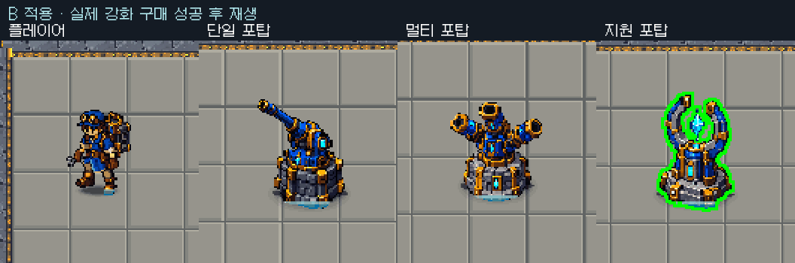

# 강화 성공 B안 적용 — 청록빛 본체 스캔

2026-10-17. 사용자 ‘난 B가 좋아 B로 적용시켜’에 따라 실제 강화 성공에 B안을 연결했다. 복구 기준 `de15d74`, 시작 tracked Assets 변경 없음·Playfalse/컴파일실패false/전투씬1·dirtyfalse. 작업 중 추가된 병행 HUD 문서 커밋 `d701909`를 보존했다. [선택 전3안](../upgrade_feedback_options_20261017/README.md), [구현 계획](plan.md).

## 현재 구현

- `CoreGuardianPrototype.UpgradePlayer/UpgradeTower`에서 기존 Session 구매의 bool 성공 반환에만 실제 대상의 `CoreGuardianUpgradeFeedback.Trigger`를 호출한다. 가격/구매 권한/능력치·증강/전투 계산은 유지한다. 기존 UI 버튼 Confirm/값 갱신/안내와 공존하며 UI 외 같은 게임 어댑터 API도 동일하게 처리한다. 재화부족/잘못된항목/단계제한 실패에는 성공 스캔을 재생하지 않는다.
- 선택한 B의 청록색 가로 띠가 본체 안쪽을 아래→위로 약0.55초 훑는다. 기존 시안과 같은 밴드 반폭0.06월드/위치진행0.48초·시작0.06초/끝0.08초 알파를 사용한다. 전체 본체 흰색 플래시·Bloom·원본 재질 교체는 없다.
- 기존 본체 합집합 마스크를 전용 disabled 런타임 인스턴스의 `PresentOverlay`로 재사용한다. 사용자 HUD 선택 아웃라인 인스턴스는 별도 유지한다. 매 LateUpdate에 현재 활성 본체 조각/변환/방향/회전 포신을 다시 합쳐 이동·보행·공격에 맞춘다. 그림자·체력바·탄환·별도 MeshRenderer 발광은 마스크에서 제외한다. 같은 GPU 테스트에서 오버레이가 합집합 밖으로 새지 않는 것도 검사한다.
- 대상별 활성 스캔은 하나다. 연속 구매는 같은 스캔을 처음부터 재시작하며 여러 레이어를 쌓지 않는다. 대상 전환/정보창 접기와 무관하게 실제 강화된 대상에서 끝까지 재생한다. 게임 시간을 따르며 비활성·대상 파괴·만료·진단 초기화 때 전용 렌더/마스크/메시/재질을 정리한다. 새 렌더러/마스크 비용을 실제 성능 계측 없이0으로 표현하지 않는다.
- 코어 입자 Inspector와 초록색 선택 아웃라인·포탑 국소 발광/조준·몸/코어 피격·원본 아트·카메라/후처리를 보존했다. 씬/프리팹 저장 변경은 없다.

## 검증

- [집중 Play red0/1](red.json): B 연결 없음 확인 → [green1/1](focused-playmode.json). 초기 골드0 구매 실패 무반응, 실제 HUD 콜백 플레이어/단일/멀티/지원 구매 성공, 연속 강화 스캔1개 유지, 잘못된항목/전투포탑강화 실패 무반응,0.7초 후 모든 스캔 만료를 확인했다. 진단 재화·TimeScale0 설정 구간이 있는 기능 QA다.
- 대칭/비대칭 GPU2건에서 본체 합집합/선택 외곽 기존 검사에 더해 실제 `UpgradeScan` 셰이더의 가로 띠가 본체 안쪽에만 그려지는지/전체 플래시가 아닌지 확인했다.
- 최종 전체 [EditMode118/118](editmode.json)·[PlayMode27/27 completed](playmode.json), 실패/스킵0. 별도 읽기 전용 코드 리뷰 actionable finding 없음.
- [실제 구매 캡처](capture.json), [재현기](CapturePurchases.cs)는 자체 Play에서 HUD 구매 콜백으로4대상을 실제 강화해 TriggerCount4/만료ActiveCount0을 확인했다. 진단 재화/플레이어 임시 비교 배치/어댑터 임시 비활성화이며 사람 직접 입력·밸런스 실측은 아니다. 효과 시계/age는 주입하지 않고 정상 deltaTime으로 재생했다. 실제36프레임 중14프레임에4스캔이 활성이고 이후0이다.
- [적용GIF](applied_B.gif)는 원래 게임63.52941픽셀/월드 배율의800×230 임시 카메라 렌더에서 각 대상132×148픽셀을 nearest2배 확대했다. 현재 후처리를 유지했다. 카메라 렌더에는 Overlay가 없으며 [별도 실제1920×1080 Overlay 화면](actual-purchase-hud.png)으로 HUD를 확인했다. [인코더](encode.py)는 실제 캡처 시간 간격을 사용한다. raw frames는 로컬 미추적 자료로 보존한다.
- 종료 자체Playfalse/pausedfalse/compilingfalse/컴파일실패false·전투씬1/dirtyfalse·TimeScale1/captureDelta0·HDRfalse/posttrue·현재콘솔오류0/경고0. 임시 카메라/RenderTexture/플레이어 위치/이동/어댑터 복원. 빌드/실행파일/push 없음. Notion은 이번에 갱신하지 않았다.

