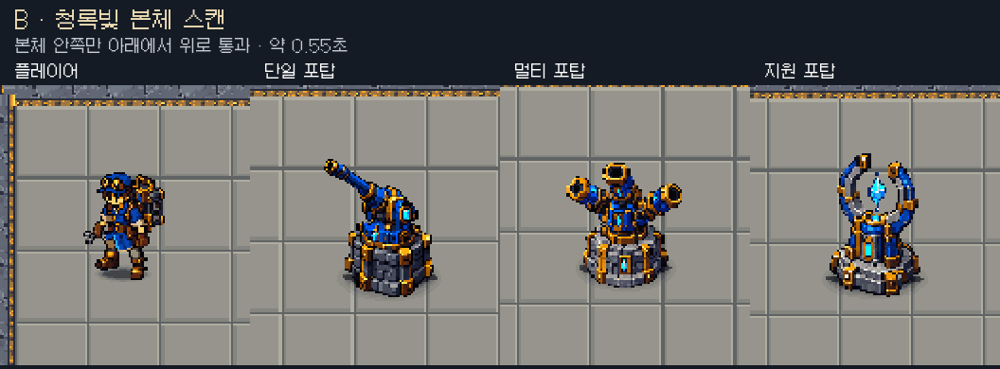
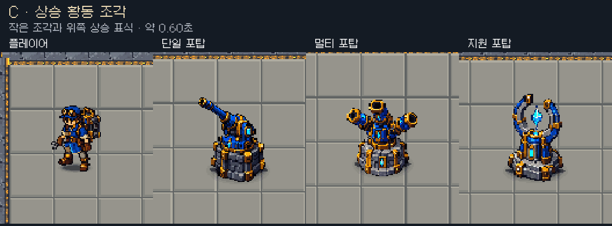

# 강화 성공 피드백 3안 — B 선택

2026-10-17 사용자 요청으로 현재 플레이어·단일/멀티/지원 포탑 원본에 맞춘 움직이는3안을 제작했다. 이후 사용자가 B를 선택해 [실제 강화 성공에 적용](../upgrade_feedback_B_20261017/README.md)했다. 아래는 선택 전 수동 시안의 제작 조건이며 A/C는 적용하지 않았다. [시안 실행 계획](plan.md).

| 안 | 표현 | 지속 | 의도 |
|---|---|---|---|
| A | 황동색 얇은 링 두 개가 발밑에서 퍼지며 약간 상승 | 약0.55초 | 본체를 가리지 않는 짧은 성공 반응 |
| B | 청록빛 가로 띠가 본체 합집합 마스크 안쪽을 아래→위로 통과 | 약0.55초 | 기계 장비가 갱신되는 인상, 세 안 중 본체 변화가 가장 큼 |
| C | 황동 조각6개가 위로 모이고 머리 위 작은 상승 표식이 나타남 | 약0.60초 | 강화·성장 의미 전달, 본체 변화는 작음 |

## 제작·실제 적용 구분

- [캡처 도구](CaptureOptions.cs)와 [시안 전용 셰이더 소스](Preview.shader)는 docs 아래에만 있다. ShaderUtil.CreateShaderAsset으로 메모리 내 임시 셰이더를 만들어 사용 후 제거했다. 새 씬·비교 씬은 만들지 않았다. 기존 전투 씬 자체 Play에서 진단 재화로 포탑3종을 배치하고 플레이어를 비교 위치로 잠시 이동·정지시켰다. 강화 성공은 수동 시계로 재생한 시안이며 실제 강화 성공/사람 플레이/밸런스 검증이 아니다.
- 실제 원본 외형·기존 idle 자세·현재 씬 바닥·현재 카메라 색보정을 사용했다. 임시 카메라는 원래 게임과 같은63.52941픽셀/월드 배율로800×230 영역을 렌더했다. ScreenSpaceOverlay HUD는 포함하지 않는다. 본체 포즈는 정지하고 후보 효과만 움직인다.
- [48프레임/30fps 캡처 조건](capture.json). [인코딩](encode.py)은 대상별132×148픽셀을 동일 nearest2배 확대해 플레이어/단일/멀티/지원4열로 배치했다. 첫/마지막은 쉼 구간이며 전체 반복은 약1.58초. 원래 배율 프레임은 `frames_1/2/3` 로컬 자료로 남기고 커밋에는 완성 GIF/대표PNG와 재현기만 포함한다. [프레임 변화 검사](gif_check.json)에서 A16/B14/C18프레임이 baseline과 다름을 확인했다.
- 최초 비교의 플레이어가 경로 옆에 가까웠고, 재촬영 시 이전 진단 배치가 남는 것을 발견해 자체 Play를 새로 시작한 깨끗한 보드에서 최종 촬영했다. 위 파일은 최종 결과다. 원본 프리팹/아트·전투 코드·사용자 초록색 선택 아웃라인은 변경하지 않았다.
- 캡처 후 임시 효과/메시/마스크/재질/셰이더/카메라/RenderTexture를 정리하고 플레이어 위치/이동/어댑터를 복원한 뒤 자체 Play를 종료했다. 새 후보를 게임에 자동 적용하지 않는다.

같이 요청한 코어 입자 Inspector 조절은 [별도 적용 기록](../core_particle_controls_20261017/README.md)을 따른다. 강화 피드백은 B 선택/적용 완료이며 코어 입자 색/크기/개수의 선호 조정은 사용자 판단을 따른다. Notion은 이번에 갱신하지 않았다.
